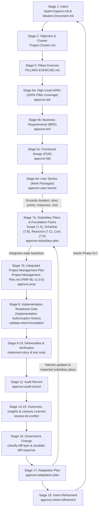

# Intent-to-Outcome Chain — PMBOK 8 Process Alignment and Closed-Loop Governance

Source of the chain concept: SocialEngage's `Intent-to-Outcome-Chain-and-TaskPolicy-Coverage.md` (Obsidian Brain wiki) and the SIDPA Project Management Lifecycle.

In enterprise software engineering and agentic governance (PMBOK 8 / SIDPA), every stage that yields a documented artifact requires a formal Bayesian validation gate. We start with a **Spark** and systematically trace intent through execution, verification, governance amendment, behavioral adaptation, and back to refined intent—closing the complete development lifecycle loop.

All document-approval policies operate under `DecisionAuthority.FULL` using multi-criteria Bayesian evaluation (`DecisionFrame`), with human adjudication mandated (`requires_human_approval: true`).

---

## 1. Document Authoring Sequence vs. Conceptual Ontology

There is an important distinction between the abstract conceptual trace and the **actual document build sequence**:

* **Conceptual Ontology (`traceabilityChain`):**
  $$\text{Intent} \longrightarrow \text{Objective} \longrightarrow \text{Hypothesis} \longrightarrow \text{Benefit} \longrightarrow \text{Pillars} \longrightarrow \text{Requirement} \longrightarrow \text{Project (PMP)} \longrightarrow \text{Readiness} \dots$$
* **Actual Document Authoring & Governance Sequence (PMBOK 8 / SIDPA Lifecycle):**
  ```
  1. Spark Capture (Intent — Initiating)
         │
  2. Ideation Document (Hypotheses — Initiating)
         │
  3. Business Case & Benefits Statement (Benefit — Initiating)
         │
  4. Project Charter (Objective — Initiating: 4.1 Develop Project Charter)
         │
  5. Pillars Exercise (Architectural Strategy Formulation: 5.3)
         │
  6. Technical Requirements & Design (Planning: 5.2 & 5.3 & 5.4)
     ├── High-Level Foundational ADRs (100% Pillar Coverage: 5.3)
     ├── Business Requirements Document (BRD: 5.2 Collect Requirements)
     ├── Functional Design Document (FDD: 5.3 Define Scope / Design)
     └── User Stories (Work Packages & WBS Decomposition: 5.4)
         │
  7. Subsidiary Management Plans (Scope 5.1/7.A, Schedule 6.1/7.B, Cost 7.1/7.D, Resource 9.1/7.C, Quality 8.1, etc.)
     & Integrated Project Management Plan (Planning: 4.2 Develop PMP — Baseline PMP-BL-v1.0.0)
         │
  8. Implementation Readiness Gate / Implementation Authorization Notice (Planning ➔ Executing Gate: validate-intent-foundation)
         │
  9. Deliverables (Executing: 4.3 Direct & Manage Work — implement-story)
         │
  10. Verification Evidence (Monitoring & Controlling: 8.3 Control Quality — Contract Test Suite)
         │
  11. Audit Record (Monitoring & Controlling: 8.2 Manage Quality Audits — Audit Register)
         │
  12. Actual Outcome (Monitoring & Controlling: 5.5 Validate Scope & Value Realization)
         │
  13. Observation (Monitoring & Controlling: 4.5 Monitor & Control Project Work — Telemetry Logs)
         │
  14. Insight (Monitoring & Controlling: 4.4 Manage Project Knowledge — Synthesis)
         │
  15. Lesson Learned (Monitoring & Controlling: 4.4 Manage Project Knowledge — Lessons Learned Register)
         │
  16. Governance Change (Monitoring & Controlling: 4.6 Integrated Change Control)
         │
  17. Adaptation Plan (Adaptive Closing / Feedback: Tailoring PMP Updates)
         │
  18. Intent Refinement (Closing: 4.7 Close Phase & Strategic Feedback to Spark)
  ```

---

## 2. Complete 18-Stage Coverage Matrix (PMBOK 8 Process & Second Brain Tooling Mapping)

| # | Chain Stage | PMBOK 8 Process Group | Governed Document Artifact | Assigned TaskPolicy | Second Brain Tooling & Scripts | Authority & Decision Shape | Lifecycle Role & IPO |
|---|---|---|---|---|---|---|---|
| 1 | **Intent** | **Initiating** | `Spark-Capture.md`<br>`Ideation-Document.md` | `approve-ideation` | `run-lifecycle-pipeline.mjs` | `FULL` (3 actions) | **Starts with a Spark.** Inputs: Trigger event / strategic driver. Process: Validate intent. Output: Approved Ideation. |
| 2 | **Objective** | **Initiating** | `Project-Charter.md` | `approve-charter` | `query-knowledge-graph.mjs` | `FULL` (3 actions) | Inputs: Business Case & Benefits. Process: Authorize project & assign sponsor. Output: Project Charter. |
| 3 | **Hypothesis** | **Initiating** | `Ideation-Document.md`<br>(`HYP-*.md`) | `classify-hypothesis-status` | `query-knowledge-graph.mjs` | `FULL` (7 actions) | Inputs: Design assumptions & test logs. Process: Evaluate empirical evidence. Output: Validated / testing status. |
| 4 | **Benefit** | **Initiating** | `Business-Case.md`<br>`Benefits-Statement.md` | `approve-business-case` | `run-lifecycle-pipeline.mjs` | `FULL` (3 actions) | Inputs: Hypotheses & ROI premise. Process: Validate economics. Output: Benefits Statement (Input to Charter). |
| 5 | **Pillars & Architecture** | **Planning** | `PILLARS-EXERCISE.md`<br>High-Level `ADR-*.md` | `approve-adr` | `ground-adrs-to-concepts.mjs` | `FULL` (3 actions) | Inputs: Project Charter & Hypotheses. Process: Decompose Charter into pillars; draft ADRs providing 100% pillar coverage. Output: Approved Pillars & ADRs. |
| 6 | **Requirement** | **Planning** | • `ADR-*.md`<br>• `BRD-*.md`<br>• `FDD-*.md`<br>• `user-stories/*.md` | • `approve-adr`<br>• `approve-brd`<br>• `approve-fdd`<br>• `approve-user-stories` | `vault-ingestion.mjs`<br>`ground-adrs-to-concepts.mjs` | `FULL` (3 actions each) | Inputs: Approved Pillars & Architecture. Process: Business requirements, functional specifications, and atomic User Stories. **Output: Approved technical requirements and work packages.** |
| 7 | **Project (PMP & Baselines)** | **Planning** | `Project-Management-Plan.md`<br>& Subsidiary Plans (5.1–13.2)<br>Foundation Packs (7.A–7.D) | • `approve-subsidiary-plan`<br>• `approve-pmp` | `orchestrate_pmbok.py --mode full` | `FULL` (3 actions each) | Inputs: Stage 6 Requirements, WBS & Foundation Packs (Scope 7.A, Schedule 7.B, Resource 7.C, Cost 7.D). Process: Ground duration/cost/scope baselines and integrate plans. Output: Approved PMP (`PMP-BL-vX.Y.Z`). |
| 8 | **Implementation Readiness** | **Planning ➔ Executing** | `Stage-8-Implementation-Authorization-Notice.md`<br>Epic Readiness Check | `validate-intent-foundation` | `run-lifecycle-pipeline.mjs` | `FULL` (3 actions: accept, reject, flag) | **Focus:** Certifies that tests, environment, criteria readiness, and planning artifacts are reconciled before developer begins implementation. Formally informs all parties that PMP is approved and authorizes staffing, procurement, and execution. Output: Provisioned git worktree. |
| 9 | **Deliverable** | **Executing** | Source Code & Release Artifacts | Direct Execution | `.claude/skills/implement-story` | Code-First TDD | Inputs: Approved stories & acceptance criteria. Process: TDD / contract-first build. Output: Executable code deliverable. |
| 10 | **Verification Evidence** | **Monitoring & Controlling** | Contract Tests & Execution Logs | Executable Test Suite | `.claude/skills/heal-contract-failure` | 4-Ring Quality Gate | Inputs: Code deliverable & contract tests. Process: Execute test suite. Output: Verification evidence report (pytest / vitest). |
| 11 | **Audit Record** | **Monitoring & Controlling** | `Audit-Register.md`<br>`Audit-Finding.md` | `approve-audit-record` | `run-lifecycle-pipeline.mjs` | `FULL` (3 actions) | Inputs: Deliverables & verification logs. Process: Audit architectural conformance. Output: Approved Audit Register entries. |
| 12 | **Actual Outcome** | **Monitoring & Controlling** | Post-Delivery Impact Assessment | Empirical Observation | `analyze-graph.mjs` | Baseline Comparison | Inputs: Production telemetry & Benefits Statement. Process: Compare realized vs expected value. Output: Impact deltas. |
| 13 | **Observation** | **Monitoring & Controlling** | Telemetry Logs & Gotchas (`OBS-*.md`) | Second Brain Ingestion | `heal-brain.mjs`<br>`diagnose-broken-links.mjs` | Raw Input | Inputs: Runtime telemetry & review findings. Process: Record raw telemetry. Output: Unfiltered observation log. |
| 14 | **Insight** | **Monitoring & Controlling** | Synthesized Technical Findings (`INSIGHT-*.md`) | `synthesis-validator.mjs` | `synthesis-validator.mjs` | `FULL` (trust existing, supersede, flag) | Inputs: Observation logs. Process: Synthesize causal significance. Output: Resolved insight node. |
| 15 | **Lesson Learned** | **Monitoring & Controlling** | Formalized Knowledge (`LL-*.md`, Register) | `resolve-kb-conflict` | `heal-brain.mjs` | `FULL` (trust existing, supersede, flag) | Inputs: Verified insights. Process: Crystallize actionable knowledge. Output: Formalized Lessons Learned register. |
| 16 | **Governance Change** | **Monitoring & Controlling** | Governance Amendments & Diffs (`GC-*.md`) | • `classify-diff-type`<br>• `escalate-diff-response` | `compile-ontology-graph.mjs` | Paired Pipeline: `FULL` / `LOW` | Inputs: Lessons learned & proposed diffs. Process: Semantic classification & escalation bandit. Output: Governed baseline update. |
| 17 | **Adaptation Plan** | **Closing / Adaptive Feedback** | `Adaptation-Plan.md` | `approve-adaptation-plan` | `orchestrate_pmbok.py --mode adapt` | `FULL` (3 actions) | Inputs: Validated Stage 16 governance change & realized outcomes. Process: Tailor PMP subsidiary plans via Governance Change Impact Matrix. Output: Impacted plan list. |
| 18 | **Intent Refinement** | **Closing / Strategic Feedback** | `Intent-Refinement-Proposal.md` | `approve-intent-refinement` | `build-18-stage-canvas.mjs`<br>`run-lifecycle-pipeline.mjs` | `FULL` (3 actions) | Inputs: Accepted Stage 17 adaptations & phase review. Process: Strategic review of original Intent. Output: **Catalyst for Phase N+1 Spark Capture**. |

---

## 3. The Continuous Adaptation & PMP Feedback Cycle



---

## 4. Directory Layout in This Template

```
sidpa-template/
├── .github/
│   └── instructions/
│       ├── codacy.instructions.md
│       └── sidpa-governance-qa.instructions.md     # Universal QA directives for agents
├── docs/
│   ├── chain-coverage.md                         # This comprehensive coverage matrix
│   ├── sequence-and-lessons.md                   # Battle-tested sequence rules and empirical lessons
│   ├── root-cause-log.md                         # Policy justifications
│   ├── project-docs/
│   │   ├── Spark-Capture.template.md              # Stage 1: Intent (Initiating)
│   │   ├── Ideation-Document.template.md          # Stage 1: Intent & Stage 3: Hypotheses (Initiating)
│   │   ├── Project-Charter.template.md            # Stage 2: Objective (Initiating: 4.1)
│   │   ├── Business-Case.template.md              # Stage 4: Benefit (Initiating)
│   │   ├── Benefits-Statement.template.md         # Stage 4: Benefit (Initiating)
│   │   ├── Project-Management-Plan.template.md    # Stage 7: PMP & Integrated Baselines (Planning: 4.2)
│   │   ├── Project-Management-Plan.md             # Stage 7: Initialized PMP instance
│   │   ├── Status-Reports/
│   │   │   └── Stage-8-Implementation-Authorization-Notice.template.md # Stage 8: Implementation Authorization
│   │   ├── Adaptation-Plan.template.md            # Stage 17: Adaptation (Monitoring & Controlling / Tailoring)
│   │   ├── Intent-Refinement-Proposal.template.md # Stage 18: Intent Refinement (Closing: 4.7)
│   │   ├── Business-Requirements/
│   │   │   └── BRD-TEMPLATE.md                    # Stage 6: Requirement (Planning: 5.2/5.3)
│   │   ├── Functional-Design/
│   │   │   └── FDD-TEMPLATE.md                    # Stage 6: Requirement (Planning: 5.3)
│   │   └── management-plans/                      # Stage 7: Subsidiary Plans (5.1–13.2) & Foundation Packs
│   │       ├── Scope-Management-Plan.md
│   │       ├── Schedule-Management-Plan.md
│   │       ├── Cost-Management-Plan.md
│   │       ├── Resource-Management-Plan.md
│   │       ├── Quality-Management-Plan.md
│   │       ├── Communications-Management-Plan.md
│   │       ├── Risk-Management-Plan.md
│   │       ├── Procurement-Management-Plan.md
│   │       ├── Stakeholder-Engagement-Plan.md
│   │       ├── scope-baseline/                    # Stage 7.A Scope Foundation Pack
│   │       ├── schedule-baseline/                 # Stage 7.B Schedule Foundation Pack
│   │       ├── resource-baseline/                 # Stage 7.C Resource Foundation Pack
│   │       └── cost-baseline/                     # Stage 7.D Cost Foundation Pack
│   ├── 07-architecture/
│   │   ├── PILLARS-TEMPLATE.md                    # Stage 5: Architectural Pillars Definition
│   │   └── ADR-TEMPLATE.md                        # Stage 6: Architectural Decision Records
│   ├── user-stories/
│   │   └── EPIC-TEMPLATE.md                       # Stage 6: Work Packages & User Stories (Planning: 5.4)
│   ├── registers/
│   │   ├── Audit-Register.template.md             # Stage 11: Audit Record (PMBOK 8.2)
│   │   └── Story-Execution-Register.template.md   # Stage 9: Deliverable Tracking (PMBOK 4.3)
│   └── policy-shapes/                             # Canonical JSON action shape specifications
├── package.json                              # npm lifecycle and Second Brain runner
├── scripts/
│   ├── brain/                                # Second Brain automation & healing suite
│   │   ├── run-lifecycle-pipeline.mjs        # 18-stage master runner
│   │   ├── heal-brain.mjs                    # Referential integrity self-healing
│   │   ├── compile-ontology-graph.mjs        # Ontology compiler & loop closure check
│   │   ├── synthesis-validator.mjs           # Decision inversion & synthesis validator
│   │   ├── brain-drift-detection.mjs         # Codebase vs ontology drift monitor
│   │   ├── build-18-stage-canvas.mjs         # Interactive 2D Obsidian canvas generator
│   │   └── query-knowledge-graph.mjs         # CLI graph query engine
│   ├── init_project.py                       # Project scaffolder
│   └── orchestrate_pmbok.py                  # PMP & subsidiary plan orchestrator
└── templates/
    └── management-plans/                          # Stage 7 Foundation Pack source templates
        ├── scope-baseline/                        # Stage 7.A Scope
        ├── schedule-baseline/                     # Stage 7.B Schedule
        ├── resource-baseline/                     # Stage 7.C Resource
        └── cost-baseline/                         # Stage 7.D Cost
```

---

## 5. Governance Invariants & Baseline Versioning Rules

1. **Requirements Ground Baselines (Invariant 1):** Technical Requirements (Stage 6: ADRs, BRDs, FDDs, User Stories) must be formulated and approved to define scope and work packages before the integrated Project Management Plan (Stage 7) and its triple baselines (Scope, Schedule, Cost) can be formally baselined (`PMP-BL-v1.0.0`).
2. **Pillars Full-Coverage Invariant (Invariant 2):** High-level foundational ADRs drafted after the Pillars Exercise must provide 100% full coverage across all identified pillars before moving to detailed requirements.
3. **User Stories ARE Work Packages (Invariant 3):** User Stories derived from FDDs with BDD acceptance criteria constitute the concrete work packages that ground the Scope (5.1/7.A), Schedule (6.1/7.B), Cost (7.1/7.D), and Resource (9.1/7.C) subsidiary plans into the integrated PMP.
4. **Governance Change Impact Matrix (Invariant 4):** Every Adaptation Plan must formally evaluate accepted Stage 16 amendments across all 9 subsidiary management plans using a structured Impact Matrix before selective re-orchestration.
5. **PMP Baseline Versioning & History Archival (Invariant 5):** Every approved PMP receives an immutable SemVer identifier (`PMP-BL-v1.0.0`, `PMP-BL-v1.1.0`). Prior baselines are atomically archived to `docs/project-docs/management-plans/history/{baseline_id}/`.
6. **Baseline Traceability Invariant (Invariant 6):** Every approved PMP, ADR, BRD, FDD, User Story, and Adaptation Plan must record its governing PMP baseline identifier (`pmp_baseline: "PMP-BL-vX.Y.Z"`).
7. **Implementation Authorization Prerequisite (Invariant 7):** No developer may commence implementation work (Stage 9) until the Stage 8 Implementation Readiness Gate formally issues an Execution Authorization Notice reconciling all Stage 6 requirements approvals and the Stage 7 PMP baseline.
8. **Deterministic Rollback Protocol (Invariant 8):** If downstream execution reveals regressions or operational failure (detected via ADR-005 `compare_decision_results()`), atomic rollback restores the prior approved baseline from archive and penalizes the escalation bandit.
