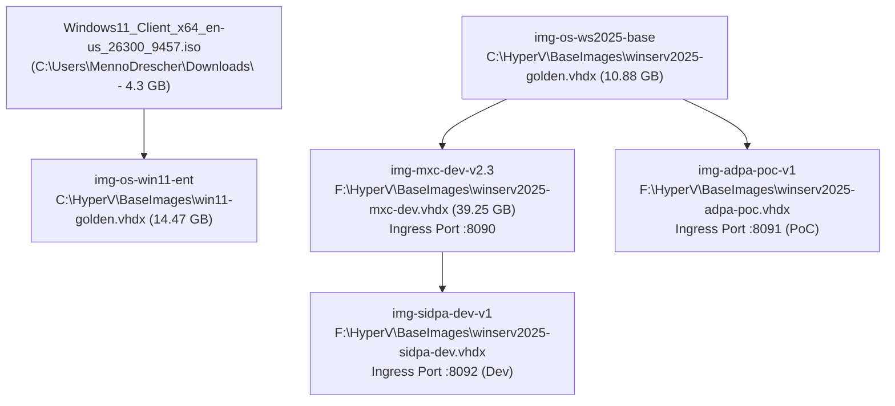

# MXC Hyper-V Golden Image Registry & Port-to-Image Catalog

> **Registry Source of Truth**: [`scripts/hyperv/dev_harness/golden_image_registry.json`](../../scripts/hyperv/dev_harness/golden_image_registry.json)  
> **CLI Inspector**: Run `mxc-images` (or `mxi`) after loading [`. .\scripts\hyperv\mxc-hyperv.ps1`](../../scripts/hyperv/mxc-hyperv.ps1)

---

## 1. Golden Image Inventory (Existing & Planned)

| Image ID | Status | VHDX Path | Size (Max) | Source / Parent | Ingress Port | Bound VM(s) | Purpose |
| :--- | :--- | :--- | :--- | :--- | :--- | :--- | :--- |
| **`img-os-ws2025-base`** | `baked_ready` | `C:\HyperV\BaseImages\winserv2025-golden.vhdx` | `10.88 GB` (`64 GB`) | Clean OS Install | `-` | Parent Base | Minimal Windows Server 2025 baseline used to stamp new workload images |
| **`img-os-win11-ent`** | `baked_ready` | `C:\HyperV\BaseImages\win11-golden.vhdx` | `14.47 GB` (`64 GB`) | `C:\Users\MennoDrescher\Downloads\Windows11_Client_x64_en-us_26300_9457.iso` (`4.3 GB`) | `-` | Client Base | Windows 11 Enterprise/Client baseline (Build `26300.9457`) |
| **`img-mxc-dev-v2.3`** | `baked_ready` | `F:\HyperV\BaseImages\winserv2025-mxc-dev.vhdx` | `39.25 GB` (`64 GB`) | `img-os-ws2025-base` | **`:8090` $\rightarrow$ `:8080`** | `mxc-hv-a7df7452` (Active)<br/>`mxc-hv-0b1e0d7e` (Standby) | Full MXC developer & JIT harness image (Rust, MSVC 2022, .NET 8, Python 3.14, Node 25, Git, `hey`, `C:\workspace`, `:8080/health`) |
| **`img-adpa-poc-v1`** | `poc_planned` | `F:\HyperV\BaseImages\winserv2025-adpa-poc.vhdx` | *Planned* (`64 GB`) | `img-os-ws2025-base` | **`:8091` $\rightarrow$ `:8080`** | `mxc-hv-0b1e0d7e` (PoC Target) | Dedicated **ADPA Proof-of-Concept** image with hardened egress rules & `baseline-hot-ready` snapshot |
| **`img-sidpa-dev-v1`** | `in_development` | `F:\HyperV\BaseImages\winserv2025-sidpa-dev.vhdx` | *Planned* (`64 GB`) | `img-mxc-dev-v2.3` | **`:8092` $\rightarrow$ `:8080`** | *Pending Provision* | Dedicated **SIDPA Development & Integration** image |

*(Additional ISO on disk: `F:\Downloads\ubuntu-24.04.4-desktop-amd64.iso`, `6.20 GB`)*

---

## 2. Image Lineage & Derivation Hierarchy



---

## 3. Quick Commands

### View Live Golden Image Registry & Disk Presence
```powershell
. .\scripts\hyperv\mxc-hyperv.ps1
mxc-images   # (or alias: mxi)
```

### Start Multi-Port JIT Ingress Gateway from Registry
```powershell
python .\scripts\hyperv\dev_harness\jit_ingress_gateway.py --registry .\scripts\hyperv\dev_harness\golden_image_registry.json
```

### Bake / Update the MXC Developer Image
```powershell
.\scripts\hyperv\bake_mxc_dev_image.ps1 -SandboxId hv:a7df7452
```

