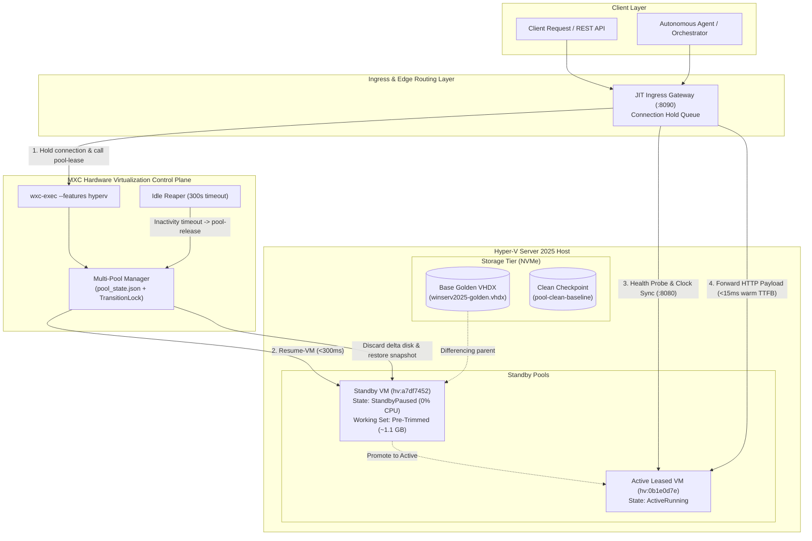

# MXC Hyper-V Subsystem & JIT Scale-to-Zero Engine

The **MXC Hyper-V Subsystem** provides hardware-enforced Type-1 virtualization for enterprise-grade automated applications (ADPA / SIDPA) and developer sandboxes on Windows Server 2025 and Windows 11 Enterprise.

It features a **Just-in-Time (JIT) Scale-to-Zero** execution model: virtual machines stay suspended in RAM or saved on disk consuming **0.0% idle CPU**, and wake on request in **`<300ms`** with zero perceptible cold-start delay for end users.

---

## Documentation Index

| Document | Purpose | Target Audience |
| :--- | :--- | :--- |
| [**User & Operator Guide**](USER_GUIDE.md) | Step-by-step instructions for running pools, configuring the JIT Gateway, and developing inside guest sandboxes | Developers, DevOps & System Operators |
| [**State-Aware Architecture**](hyperv-state-aware.md) | Deep-dive into the Rust control plane (`HypervRunner`), lifecycle phases, and transition locks | MXC Core Engineers |
| [**Golden Image Registry**](GOLDEN_IMAGE_REGISTRY.md) | Inventory of base VHDX images, NVMe storage tiers, and snapshot baselines | Infrastructure Engineers |
| [**Master Architecture (ADD)**](architecture/ARCHITECTURE_DESIGN_DOCUMENT.md) | Formal Architecture Design Document (ARB approved) covering all system pillars | Architects & ARB Committees |
| [**Architectural Decisions (ADR)**](architecture/ADR.md) | Records of architectural decisions (ADR-001 through ADR-007) | Architecture & Security Teams |
| [**Functional Design (FDD)**](architecture/FDD.md) | Technical specifications for gateway buffering, pool replenishment, and reaping | Systems Engineers |
| [**User Stories & Acceptance**](architecture/USER_STORIES.md) | Formal acceptance criteria (`AC-01` through `AC-05`) and testable invariants | QA & Engineering Leads |

---

## Architecture Diagram



---

## Quick Start (3 Steps)

### 1. Build the Control Plane
```powershell
cd src
cargo build --features hyperv -p wxc --bin wxc-exec
```

### 2. Launch the JIT Ingress Gateway
```powershell
python scripts\hyperv\dev_harness\jit_ingress_gateway.py --port 8090 --pool prod-adpa
```

### 3. Send a Request
```powershell
Invoke-RestMethod -Uri "http://localhost:8090/api/v1/adpa/process" `
    -Method Post `
    -Body '{"job": "verification"}' `
    -ContentType "application/json"
```

---

## Directory Structure

```text
mxc/
├── docs/hyperv/
│   ├── README.md                          # This file (Subsystem entrypoint)
│   ├── USER_GUIDE.md                      # Step-by-step user & operator guide
│   ├── GOLDEN_IMAGE_REGISTRY.md           # Storage tiers and image catalog
│   ├── hyperv-state-aware.md              # State-aware lifecycle specification
│   └── architecture/                      # Formal ADD, ADR, BDR, FDD specifications
├── scripts/hyperv/
│   ├── bake_golden_image.ps1              # Base VHDX image baking script
│   ├── register-guest-credential.ps1      # Windows Credential Manager registrar
│   └── dev_harness/
│       ├── jit_ingress_gateway.py         # Production JIT Ingress Reverse Proxy
│       ├── benchmark_jit_wake.py          # Automated verification & benchmark suite
│       ├── mock_adpa_service.py           # In-guest reference workload & health endpoint
│       └── golden_image_registry.json     # Machine-readable image & route registry
└── src/mxc-sdk/src/backends/hyperv/
    ├── common/                            # Cmdlet wrappers, probe, credentials
    └── lifecycle/                         # Pool manager, control plane, state-aware runner
```
