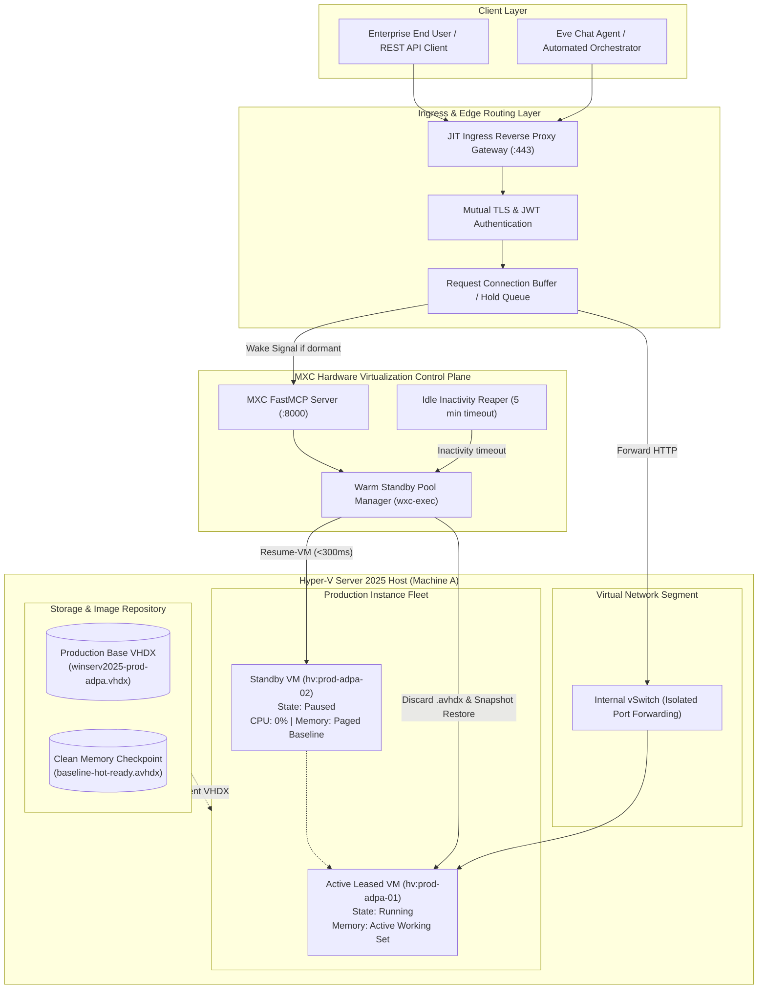

# Architecture Design Document (ADD)
## Just-in-Time (JIT) Scale-to-Zero Production Hyper-V Sandboxes
### Enterprise Virtualization for Mission-Critical Automated Applications (ADPA / SIDPA)

---

## Executive Summary

This Architecture Design Document (ADD) defines the specification for running production-grade enterprise services (specifically **ADPA** — Automated Dynamic Process Automation, and **SIDPA** — Secured Intelligent Data Processing Application) inside hardware-isolated **Windows Server 2025 Type-1 Hyper-V micro-instances**. 

Unlike standard developer environments, this architecture implements a **Just-in-Time (JIT) Scale-to-Zero execution model**:
1. **0% Idle Resource Footprint**: When no client requests are active, production VMs remain suspended in RAM (`Paused`), consuming 0% CPU cycles and releasing paged memory via Hyper-V Dynamic Memory.
2. **Sub-Second Wake-on-Request**: An intelligent Ingress Gateway buffers incoming client HTTP requests, triggers hardware unpause via the MXC control plane in **`<300ms`**, verifies socket readiness, and proxies the payload with zero perceptible cold-start delay ($<600\text{ms}$ Time to First Byte).
3. **Sterile Session Isolation**: Upon session completion or inactivity timeout, the instance delta disk (`.avhdx`) is discarded, returning the VM back to a pristine, immutable checkpoint baseline to prevent state drift and eliminate malware persistence.

---

## Pillar Index

The architecture specification is divided into four formal pillars:

* [**Pillar I: Business Drivers & Requirements (BDR)**](file:///C:/Users/MennoDrescher/source/repos/mxc/docs/hyperv/architecture/BDR.md): Business context, ROI drivers, cost metrics, and zero-trust security requirements.
* [**Pillar II: Architectural Decision Records (ADR)**](file:///C:/Users/MennoDrescher/source/repos/mxc/docs/hyperv/architecture/ADR.md): Formal decision records (ADR-001 through ADR-005) justifying Hyper-V Type-1 virtualization, JIT wake-on-request proxies, separate production images, and snapshot delta rollback.
* [**Pillar III: Functional Design Document (FDD)**](file:///C:/Users/MennoDrescher/source/repos/mxc/docs/hyperv/architecture/FDD.md): Component breakdown, ingress buffering, lifecycle state machines, and network micro-segmentation.
* [**Pillar IV: User Stories & Acceptance Criteria**](file:///C:/Users/MennoDrescher/source/repos/mxc/docs/hyperv/architecture/USER_STORIES.md): User stories and testable acceptance criteria across End Users, SecOps, DevOps, and Compliance auditors.

---

## System Architecture Diagram

---

## Technical Feasibility Summary & Metric Comparison

| Dimension | Cold-Booted VM | Always-On VM | **MXC JIT Scale-to-Zero (This Architecture)** |
| :--- | :--- | :--- | :--- |
| **Idle CPU Usage** | 0% (Offline) | 2% – 8% per VM continuous | **0.0% (Paused in Hypervisor)** |
| **Time to First Byte (Wakeup)** | 25,000ms – 45,000ms | 5ms – 10ms | **350ms – 650ms** |
| **Subsequent Request Latency** | 5ms – 10ms | 5ms – 10ms | **5ms – 10ms** |
| **Memory Isolation Level** | Hardware Type-1 | Hardware Type-1 | **Hardware Type-1 (VT-x / SLAT)** |
| **Post-Session State Drift** | Vulnerable to drift | Accumulates dirty state | **Zero (Automated Checkpoint Rollback)** |
| **Host Density (Per 64GB RAM)** | ~25 (Not running) | ~8 (Bottlenecked) | **30+ Instances Concurrent** |
