# Architecture Design Document (ADD)
## Just-in-Time (JIT) Scale-to-Zero Production Hyper-V Sandboxes
### Enterprise Virtualization for Mission-Critical Automated Applications (ADPA / SIDPA)

---

### Document Control & Metadata
* **System Name**: MXC Production JIT Virtualization Engine
* **Target Workloads**: Automated Dynamic Process Automation (ADPA) / Secured Intelligent Data Processing Application (SIDPA)
* **Date**: October 2026
* **Status**: Approved for Implementation
* **Deciders**: Systems Architecture Team
* **Infrastructure Layer**: Rust Hyper-V Control Plane (`mxc-sdk`, `wxc-exec --features hyperv`) + FastMCP Ingress Gateway + Vercel Eve / Edge Proxy

---

## 1. Executive Summary

This Architecture Design Document (ADD) defines the unified enterprise specification for running production-grade services (specifically **ADPA** — Automated Dynamic Process Automation, and **SIDPA** — Secured Intelligent Data Processing Application) inside hardware-isolated **Windows Server 2025 Type-1 Hyper-V micro-instances**. 

Unlike standard developer environments, this architecture implements a **Just-in-Time (JIT) Scale-to-Zero execution model**:
1. **0% Idle Resource Footprint**: When no client requests are active, production VMs remain suspended in RAM (`Paused`), consuming 0.0% CPU cycles and releasing paged memory via Hyper-V Dynamic Memory.
2. **Sub-Second Wake-on-Request**: An intelligent Ingress Gateway buffers incoming client HTTP requests, triggers hardware unpause via the MXC control plane in **`<300ms`**, verifies socket readiness (`:8080/health`), and proxies the payload with zero perceptible cold-start delay ($<600\text{ms}$ Time to First Byte).
3. **Sterile Session Isolation**: Upon session completion or inactivity timeout ($300\text{s}$), the instance delta disk (`.avhdx`) is discarded, returning the VM back to a pristine, immutable checkpoint baseline (`baseline-hot-ready`) to prevent state drift and eliminate malware persistence.
4. **Elastic Ready-State Autoscaling**: As soon as requirements, concurrency velocity, or schedules signal increased demand, the warm pool manager automatically replenishes and expands the ready-state paused buffer ($K_{\text{min}} \rightarrow K_{\text{max}}$) so concurrent requests never experience cold boots or queuing delays.

---

## 2. Pillar Index

The complete architecture specification is organized into four formal pillars (available both in this unified repository suite and as standalone executive `.docx` artifacts):

* [**Pillar I: Business Drivers & Requirements (BDR)**](file:///C:/Users/MennoDrescher/source/repos/mxc/docs/hyperv/architecture/BDR.md): Executive context, ROI drivers (BDR-01 to BDR-04), quantitative cost/density metrics, requirements matrix (REQ-BDR-01 to REQ-BDR-05), and future horizon scaling enhancements.
* [**Pillar II: Architectural Decision Records (ADR)**](file:///C:/Users/MennoDrescher/source/repos/mxc/docs/hyperv/architecture/ADR.md): Formal decision records (ADR-001 through ADR-006) justifying Type-1 Hyper-V virtualization, JIT connection-buffering proxies, separate hardened production images, memory-preserved standby, automated differencing disk rollbacks, and dynamic watermark pool autoscaling.
* [**Pillar III: Functional Design Document (FDD)**](file:///C:/Users/MennoDrescher/source/repos/mxc/docs/hyperv/architecture/FDD.md): Component specifications, JSON route definitions, elastic standby watermark replenishment algorithm, lifecycle state machines, wake-on-request sequence flows, and automated reaping protocols.
* [**Pillar IV: User Stories & Acceptance Criteria**](file:///C:/Users/MennoDrescher/source/repos/mxc/docs/hyperv/architecture/USER_STORIES.md): BDD/Gherkin user stories (US-01 through US-05) across End Users, SecOps/CISO, DevOps/SRE, and Software Release Engineers.

---

## 3. System Architecture Topology (Mermaid Specification)

```mermaid
flowchart TD
    subgraph Clients["Client Layer"]
        User["Enterprise End User / REST API Client"]
        ChatAgent["Eve Chat Agent / Automated Orchestrator"]
    end

    subgraph Ingress["Ingress & Edge Routing Layer"]
        Proxy["JIT Ingress Reverse Proxy Gateway (:443)"]
        BufferQueue["Request Connection Buffer / Hold Queue"]
        AuthZ["Mutual TLS & JWT Authentication"]
    end

    subgraph ControlPlane["MXC Hardware Virtualization Control Plane"]
        FastMCP["MXC FastMCP Server (:8000)"]
        PoolManager["Warm Standby Pool Manager (wxc-exec)"]
        Reaper["Idle Inactivity Reaper (5 min timeout)"]
    end

    subgraph HyperVHost["Hyper-V Server 2025 Host (Machine A)"]
        subgraph NetworkIsolation["Virtual Network Segment"]
            Switch["Internal vSwitch (Isolated Port Forwarding)"]
        end

        subgraph VMPool["Production Instance Fleet"]
            ActiveVM["Active Leased VM (hv:prod-adpa-01)\nState: Running\nMemory: Active Working Set"]
            StandbyVM["Standby VM (hv:prod-adpa-02)\nState: Paused\nCPU: 0% | Memory: Paged Baseline"]
        end

        subgraph StorageSubsystem["Storage & Image Repository"]
            GoldenProdVHDX[("Production Base VHDX\n(winserv2025-prod-adpa.vhdx)")]
            SnapshotBaseline[("Clean Memory Checkpoint\n(baseline-hot-ready.avhdx)")]
        end
    end

    User --> Proxy
    ChatAgent --> Proxy
    Proxy --> AuthZ
    AuthZ --> BufferQueue
    BufferQueue -- "Wake Signal if dormant" --> FastMCP
    FastMCP --> PoolManager
    PoolManager -- "Resume-VM (<300ms)" --> StandbyVM
    StandbyVM -.-> ActiveVM
    BufferQueue -- "Forward HTTP" --> Switch
    Switch --> ActiveVM
    Reaper -- "Inactivity timeout" --> PoolManager
    PoolManager -- "Discard .avhdx & Snapshot Restore" --> ActiveVM
    StorageSubsystem -. "Parent VHDX" .-> VMPool
```

---

## 4. Technical Feasibility & Metric Comparison

| Dimension | Cold-Booted VM | Always-On VM | **MXC JIT Scale-to-Zero (This Architecture)** |
| :--- | :--- | :--- | :--- |
| **Idle CPU Usage** | 0% (Offline) | 2% – 8% per VM continuous | **0.0% (Paused in Hypervisor)** |
| **Time to First Byte (Wakeup)** | 25,000ms – 45,000ms | 5ms – 10ms | **350ms – 650ms ($\le 800\text{ms}$ SLA)** |
| **Subsequent Request Latency** | 5ms – 10ms | 5ms – 10ms | **5ms – 10ms ($\le 15\text{ms}$ SLA)** |
| **Memory Isolation Level** | Hardware Type-1 | Hardware Type-1 | **Hardware Type-1 (VT-x / AMD-V / SLAT)** |
| **Post-Session State Drift** | Vulnerable to drift | Accumulates dirty state | **Zero (Automated Checkpoint Rollback)** |
| **Host Density (Per 64GB RAM)** | ~25 (Not running) | ~8 (Bottlenecked) | **30+ Instances Concurrent** |

---

## 5. Future Horizon & Scaling Enhancement (Architectural Roadmap)

> [!TIP]
> **1. Multi-Region Hypervisor Mesh**: Expand the MXC Rust control plane across geo-distributed bare-metal Hyper-V clusters paired with Anycast DNS edge proxies to guarantee $<100\text{ms}$ global ingress socket acceptance.
>
> **2. Carbon-Aware Workload Scheduling**: Dynamically shift suspended VM resume operations and background image baking pipelines to data centers operating at peak renewable energy availability.
>
> **3. Confidential Computing Partitions**: Integrate hardware-enforced memory encryption (AMD SEV-SNP / Intel TDX) at the Hyper-V guest partition level for cryptographic isolation even against host-level inspection.
