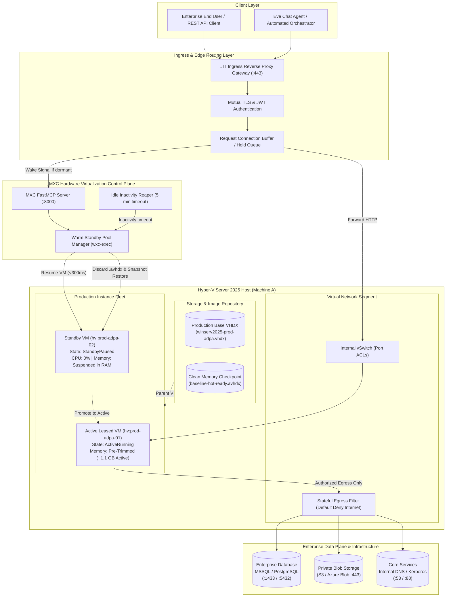

# Architecture Design Document (ADD)
## Just-in-Time (JIT) Scale-to-Zero Production Hyper-V Sandboxes
### Enterprise Virtualization for Mission-Critical Automated Applications (ADPA / SIDPA)

---

### Document Control & Metadata
* **System Name**: MXC Production JIT Virtualization Engine
* **Target Workloads**: Automated Dynamic Process Automation (ADPA) / Secured Intelligent Data Processing Application (SIDPA)
* **Date**: October 2026
* **Status**: Approved for Implementation
* **Deciders**: Systems Architecture Team
* **Infrastructure Layer**: Rust Hyper-V Control Plane (`mxc-sdk`, `wxc-exec --features hyperv`) + FastMCP Ingress Gateway + Vercel Eve / Edge Proxy

---

## 1. Executive Summary

This Architecture Design Document (ADD) defines the unified enterprise specification for running production-grade services (specifically **ADPA** — Automated Dynamic Process Automation, and **SIDPA** — Secured Intelligent Data Processing Application) inside hardware-isolated **Windows Server 2025 Type-1 Hyper-V micro-instances**. 

Unlike standard developer environments, this architecture implements a **Just-in-Time (JIT) Scale-to-Zero execution model**:
1. **0% Idle Resource Footprint**: When no client requests are active, production VMs remain suspended in RAM (`StandbyPaused`), consuming 0.0% CPU cycles with a lean, pre-trimmed static working set ($\approx 1.0\text{ – }1.2\text{ GB}$).
2. **Sub-Second Wake-on-Request**: An intelligent Ingress Gateway buffers incoming client HTTP requests, triggers hardware unpause via the MXC control plane in **`<300ms`**, verifies socket readiness (`:8080/health`), and proxies the payload with zero perceptible cold-start delay ($350\text{ms} - 650\text{ms}$ nominal, $\le 800\text{ms}$ SLA Time to First Byte).
3. **Sterile Session Isolation & Internal Data Plane**: Upon session completion or inactivity timeout ($300\text{s}$), the instance delta disk (`.avhdx`) is discarded, returning the VM back to a pristine, immutable checkpoint baseline (`baseline-hot-ready`) to prevent state drift and eliminate malware persistence. Arbitrary public internet is blocked (airgap mode), while outbound traffic is permitted strictly to internal enterprise datastores (SQL Server, PostgreSQL, S3 private endpoints) and infrastructure services (Internal DNS, Kerberos).
4. **Cryptographic & Temporal Integrity**: Upon hypervisor unpause, the guest service forcibly re-seeds its PRNG entropy pool via hardware CPU instructions (`RDRAND`/`RDSEED`), purges stale database connection pools (`ClearAllPools()`), and verifies host VMBus clock synchronization before reporting healthy readiness.
5. **Elastic Ready-State Autoscaling**: As soon as requirements, concurrency velocity, or schedules signal increased demand, the warm pool manager automatically replenishes and expands the ready-state paused buffer ($K_{\text{min}} \rightarrow K_{\text{max}}$) so concurrent requests never experience cold boots or queuing delays.

---

## 2. Pillar Index

The complete architecture specification is organized into four formal pillars (available both in this unified repository suite and as standalone executive `.docx` artifacts):

* [**Pillar I: Business Drivers & Requirements (BDR)**](file:///C:/Users/MennoDrescher/source/repos/mxc/docs/hyperv/architecture/BDR.md): Executive context, ROI drivers (BDR-01 to BDR-04), quantitative cost/density metrics, requirements matrix (REQ-BDR-01 to REQ-BDR-05), and future horizon scaling enhancements.
* [**Pillar II: Architectural Decision Records (ADR)**](file:///C:/Users/MennoDrescher/source/repos/mxc/docs/hyperv/architecture/ADR.md): Formal decision records (ADR-001 through ADR-007) justifying Type-1 Hyper-V virtualization, JIT connection-buffering proxies, separate hardened production images, memory-preserved standby, automated differencing disk rollbacks, dynamic watermark pool autoscaling, and hardware PRNG/DB hygiene.
* [**Pillar III: Functional Design Document (FDD)**](file:///C:/Users/MennoDrescher/source/repos/mxc/docs/hyperv/architecture/FDD.md): Component specifications, JSON route definitions, elastic standby watermark replenishment algorithm, lifecycle state machines, wake-on-request sequence flows, and automated reaping protocols.
* [**Pillar IV: User Stories & Acceptance Criteria**](file:///C:/Users/MennoDrescher/source/repos/mxc/docs/hyperv/architecture/USER_STORIES.md): BDD/Gherkin user stories (US-01 through US-05) across End Users, SecOps/CISO, DevOps/SRE, and Software Release Engineers.
* [**Master Implementation Plan & Traceability Matrix**](file:///C:/Users/MennoDrescher/source/repos/mxc/docs/hyperv/architecture/IMPLEMENTATION_PLAN.md): Four-phase implementation roadmap, story completion matrices, and active delivery milestones.

---

## 3. System Architecture Topology (Mermaid Specification)



---

## 4. Technical Feasibility & Metric Comparison

| Dimension | Cold-Booted VM | Always-On VM | **MXC JIT Scale-to-Zero (This Architecture)** |
| :--- | :--- | :--- | :--- |
| **Idle CPU Usage** | 0% (Offline) | 2% – 8% per VM continuous | **0.0% (Paused in Hypervisor)** |
| **Time to First Byte (Wakeup)** | 25,000ms – 45,000ms | 5ms – 10ms | **350ms – 650ms ($\le 800\text{ms}$ SLA)** |
| **Subsequent Request Latency** | 5ms – 10ms | 5ms – 10ms | **5ms – 10ms ($\le 15\text{ms}$ SLA)** |
| **Memory Isolation Level** | Hardware Type-1 | Hardware Type-1 | **Hardware Type-1 (VT-x / AMD-V / SLAT)** |
| **Post-Session State Drift** | Vulnerable to drift | Accumulates dirty state | **Zero (Automated Checkpoint Rollback)** |
| **Host Density (Per 64GB RAM)** | ~25 (Not running) | ~8 (Bottlenecked) | **30+ Instances Concurrent** |

---

## 5. Future Horizon & Scaling Enhancement (Architectural Roadmap)

> [!TIP]
> **1. Multi-Region Hypervisor Mesh**: Expand the MXC Rust control plane across geo-distributed bare-metal Hyper-V clusters paired with Anycast DNS edge proxies to guarantee $<100\text{ms}$ global ingress socket acceptance.
>
> **2. Carbon-Aware Workload Scheduling**: Dynamically shift suspended VM resume operations and background image baking pipelines to data centers operating at peak renewable energy availability.
>
> **3. Confidential Computing Partitions**: Integrate hardware-enforced memory encryption (AMD SEV-SNP / Intel TDX) at the Hyper-V guest partition level for cryptographic isolation even against host-level inspection.

---

## 6. Architecture Implementation Plan & Master Roadmap

The delivery roadmap translates the architectural pillars into four testable execution phases:

```text
[ Phase 1: Core Engine & Isolation ] ────> [ Phase 2: Multi-Pool & Ingress ] ────> [ Phase 3: Production Hardening ] ────> [ Phase 4: Enterprise Mesh ]
  • ADR-001 (Type-1 Hypervisor) ✅          • ADR-002 (JIT Ingress Proxy) ✅          • US-04 / ADR-003 (Clean Baking) 🟡       • ADR-005 (WORM RAM Disks) ⚪
  • ADR-004 (Paused RAM State) ✅           • ADR-006 (Multi-Pool Scaling) ✅         • AC-02.3 (Network Port ACLs) 🟡          • Multi-Node Anycast Mesh ⚪
  • #1491 (Host Probe Coverage) ✅          • AC-05.1 (Auto-Replenish) ✅             • FastMCP Tool Integration 🟡             • AMD SEV-SNP / Intel TDX ⚪
```

### Execution Phases & Story Traceability

| Phase / Milestone | Core Deliverables & Acceptance Criteria | Target SLA | Status |
| :--- | :--- | :--- | :--- |
| **Phase 1: Core Engine & Isolation** | **ADR-001, ADR-004, US-03 (`AC-03.1`–`AC-03.3`), #1491**: Type-1 VM creation, pre-trimmed working sets, `0.0%` idle CPU, `<300ms` resume, and `--available-backends` probe detection. | 0.0% CPU, Lean RAM | **100% Complete ✅** |
| **Phase 2: Multi-Pool & Ingress Routing** | **ADR-002, ADR-006, ADR-007, US-01 (`AC-01.1`–`AC-01.3`), US-02 (`AC-02.1`, `AC-02.4`), US-05 (`AC-05.1`, `AC-05.3`, `AC-05.4`)**: Reverse proxy hold queue, dynamic pool leasing, detached auto-replenish, hardware PRNG re-seed, DB pool flush, and in-flight 504 timeouts. | TTFB $\le 800\text{ms}$ cold, $\le 25\text{ms}$ warm | **100% Complete ✅** |
| **Milestone 3.1: Clean Base Images** | **ADR-003, US-04 (`AC-04.1`, `AC-04.2`)**: Automated release audit script (`audit_production_image.ps1`) verifying absence of Scoop/uv/cargo/git in production VHDX, plus automated headless image baking with hot cache snapshot. | Clean VHDX, Zero Dev Debris | **Active 🟡** |
| **Milestone 3.2: Network Security & Port ACLs** | **ADR-005, US-02 (`AC-02.3`, `AC-02.2`)**: Hyper-V Port ACL script (`configure_port_acls.ps1`) enforcing Default Deny public internet with whitelist for SQL `:1433`, PostgreSQL `:5432`, Blob `:443`, DNS `:53`, and Kerberos `:88`. Parent VHDX SHA-256 verification. | Airgap Mode + Whitelist | **Active 🟡** |
| **Milestone 3.3: FastMCP Agent & Velocity Autoscaling** | **US-05 (`AC-05.2`), FastMCP Tools**: Native MCP tools in `mxc_mcp_server.py` (`hyperv_pool_list`, `hyperv_pool_warm`, `hyperv_gateway_status`) and velocity-triggered expansion to $K_{\text{max}}$ when req/s > 10. | Dynamic $K_{\text{min}} \rightarrow K_{\text{max}}$ | **Active 🟡** |
| **Phase 4: High-Throughput I/O & Fleet Mesh** | **ADR-005 Future, US-05 Future, ADD Section 12**: WORM memory-backed scratch disks, multi-node Hyper-V cluster orchestration with Anycast edge routing, and AMD SEV-SNP / Intel TDX confidential computing partitions. | $<100\text{ms}$ global ingress | **Planned ⚪** |

*For complete details, task breakdowns, and verification procedures, see the dedicated [**Master Implementation Plan & Traceability Matrix**](file:///C:/Users/MennoDrescher/source/repos/mxc/docs/hyperv/architecture/IMPLEMENTATION_PLAN.md).*

