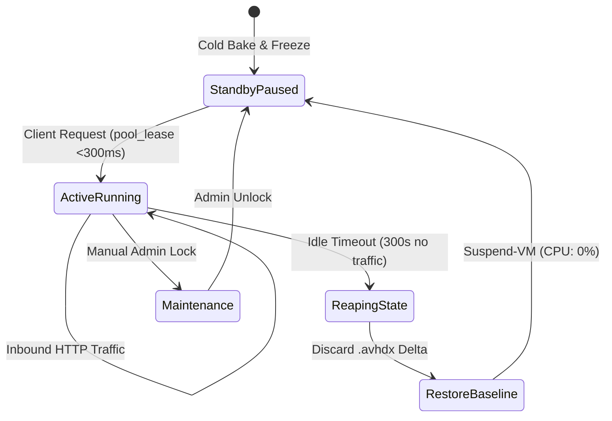
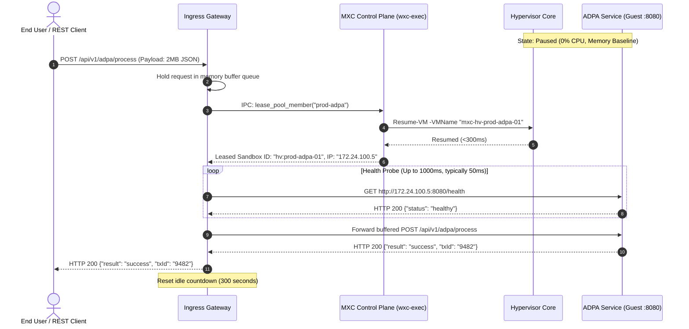

# Pillar III: Functional Design Document (FDD)
## Just-in-Time (JIT) Scale-to-Zero Production Hyper-V Sandboxes

---

## 1. System Architecture & Subsystem Decomposition

```
┌────────────────────────────────────────────────────────────────────────┐
│                        MXC Production Subsystems                       │
├───────────────────┬───────────────────┬────────────────────────────────┤
│ 1. Ingress Proxy  │ 2. Lifecycle      │ 3. Guest Production Appliance  │
│    Gateway        │    Controller     │    (ADPA / SIDPA)              │
│ - Buffer Queue    │ - Warm Pool Mgr   │ - Production Windows Service   │
│ - Wake Signal IPC │ - Inactivity Reap │ - Health Probe (:8080/health)  │
│ - Health Poller   │ - Differencing    │ - Internal Isolated Virtual NIC│
│ - Session Tracker │   Disk Discard    │ - Memory-Resident Working Set  │
└───────────────────┴───────────────────┴────────────────────────────────┘
```

---

## 2. Component Specifications

### 2.1 Component 1: JIT Ingress Proxy Gateway
* **Technology**: Reverse Proxy Engine (YARP / Envoy / FastMCP Gateway) running as a system service on the Hyper-V host or DMZ node.
* **Responsibilities**:
  1. Terminate client TLS connections (`:443`).
  2. Match incoming request paths to production pool targets (e.g., `/api/v1/adpa/*` ➔ `pool:prod-adpa`).
  3. Maintain a buffered connection queue while instances are dormant.
  4. Dispatch wake commands to the MXC lifecycle controller.
  5. Proxy HTTP requests and stream responses.
  6. Reset session inactivity timers on each packet.

* **Proxy Route Configuration**:
  ```json
  {
    "route_id": "adpa_production_service",
    "match_path": "/api/v1/adpa/{**catch-all}",
    "target_pool": "prod-adpa",
    "guest_port": 8080,
    "wake_timeout_ms": 3000,
    "idle_timeout_seconds": 300,
    "health_check_path": "/health"
  }
  ```

---

### 2.2 Component 2: MXC Hardware Lifecycle Controller (`wxc-exec`)
* **Technology**: Native Rust Hyper-V Backend (`src/mxc-sdk/src/backends/hyperv/`).
* **Responsibilities**:
  1. Maintain pool state in `%ProgramData%\mxc\hyperv\pool\pool_state.json`.
  2. Execute sub-300ms `pool-lease` operations using hypervisor `Resume-VM`.
  3. Execute `pool-release` operations: restore baseline snapshot, discard delta differencing disk (`.avhdx`), suspend VM via `Suspend-VM`.
  4. Provide FastMCP / REST telemetry on instance state, CPU, RAM, and uptime.

* **Lifecycle State Machine**:



---

### 2.3 Component 3: Guest Production Appliance (ADPA / SIDPA)
* **Operating System**: Windows Server 2025 Core or Hardened Desktop Experience.
* **Pre-Baking Configuration**:
  * **Service Architecture**: Application runs as a self-hosted Windows Service (Kestrel / FastAPI / Go service) listening on internal loopback `0.0.0.0:8080`.
  * **Health Check Endpoint**: `GET /health` returns JSON `{"status": "healthy", "service": "ADPA", "uptime_ms": 1240}` in $<5\text{ms}$.
  * **Memory Optimization**: Assemblies pre-compiled (Native AOT or NGen). Working set memory warmed before taking the golden baseline checkpoint.
  * **Security Profile**: Windows Firewall blocks all inbound traffic except port `8080` from the host internal virtual switch. All outbound internet traffic blocked (airgap mode).

---

## 3. Protocol & Execution Sequence (Wake-on-Request)



---

## 4. Automated Reaping & Baseline Reset Protocol

1. **Inactivity Detection**:
   * The Ingress Gateway records the timestamp of the last transmitted packet for `hv:prod-adpa-01`.
   * When elapsed time $> \text{idle\_timeout\_seconds}$ (default: 300s):
2. **Rollback Execution**:
   * Ingress Proxy issues `pool_release("hv:prod-adpa-01")`.
   * MXC executes rollback protocol:
     1. Disconnects network adapter.
     2. Restores VM to named checkpoint `baseline-hot-ready`.
     3. Deletes active child differencing disk (`.avhdx`).
     4. Invokes `Suspend-VM` to place VM in zero-CPU paused state.
     5. Marks instance as `ready` in pool registry.
