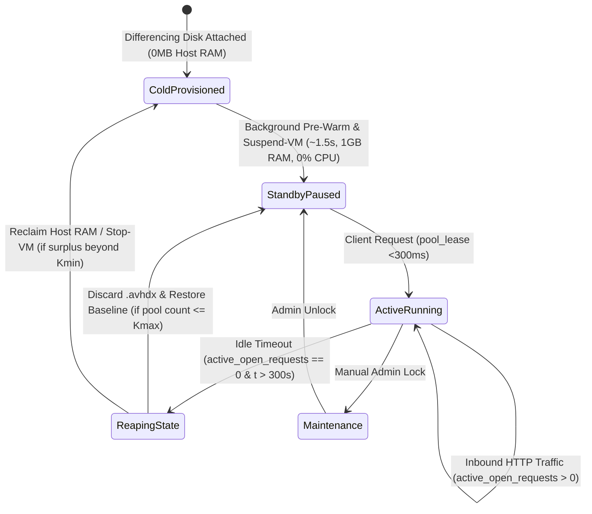
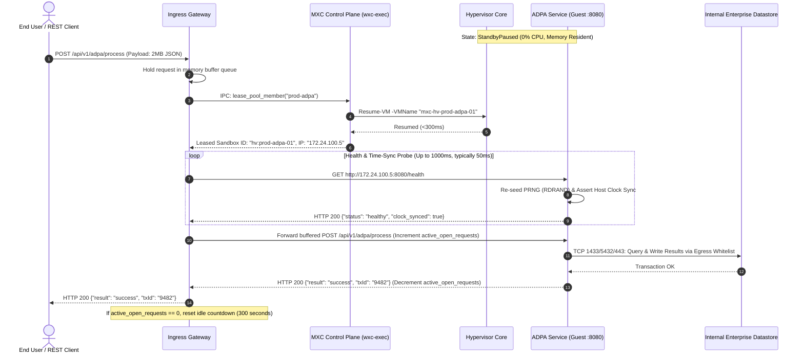

# Pillar III: Functional Design Document (FDD)
## Just-in-Time (JIT) Scale-to-Zero Production Hyper-V Sandboxes (ADPA / SIDPA)

---

## 1. System Architecture & Subsystem Decomposition

```
┌────────────────────────────────────────────────────────────────────────┐
│                        MXC Production Subsystems                       │
├───────────────────┬───────────────────┬────────────────────────────────┤
│ 1. Ingress Proxy  │ 2. Lifecycle      │ 3. Guest Production Appliance  │
│    Gateway        │    Controller     │    (ADPA / SIDPA)              │
│ - Buffer Queue    │ - Warm Pool Mgr   │ - Production Windows Service   │
│ - Wake Signal IPC │ - Inactivity Reap │ - Health Probe (:8080/health)  │
│ - Health Poller   │ - Differencing    │ - Internal Isolated Virtual NIC│
│ - Session Tracker │   Disk Discard    │ - Memory-Resident Working Set  │
└───────────────────┴───────────────────┴────────────────────────────────┘
```

---

## 2. Component Specifications

### 2.1 Component 1: JIT Ingress Proxy Gateway
* **Technology**: Reverse Proxy Engine (YARP / Envoy / FastMCP Gateway) running as a system service on the Hyper-V host or DMZ node.
* **Responsibilities**:
  1. Terminate client TLS connections (`:443`).
  2. Match incoming request paths to production pool targets (e.g., `/api/v1/adpa/*` ➔ `pool:prod-adpa`).
  3. Maintain a buffered connection queue while instances are dormant.
  4. Dispatch synchronous wake commands (`pool_lease`) to the MXC lifecycle controller.
  5. Poll guest health endpoint (`:8080/health`), proxy HTTP requests, and stream responses back to the client.
  6. **In-Flight Request Tracking & Draining**: Maintains atomic `active_open_requests` counter. The idle timeout timer decrements strictly when `active_open_requests == 0`. Long-running processing (>300s) is protected from premature reaping.
  7. **Atomic Reaping Lock (Race Prevention)**: When inactivity triggers reaping, the proxy acquires a `TransitionLock` that marks the instance as `Reaping` in the routing table *before* signaling network disconnection, ensuring any simultaneous request arriving at `t = 300.01s` instantly leases the next available `StandbyPaused` instance.

* **Proxy Route Configuration Schema**:
  ```json
  {
    "route_id": "adpa_production_service",
    "match_path": "/api/v1/adpa/{**catch-all}",
    "target_pool": "prod-adpa",
    "guest_port": 8080,
    "wake_timeout_ms": 3000,
    "idle_timeout_seconds": 300,
    "health_check_path": "/health"
  }
  ```

> [!TIP]
> **Future Horizon & Scaling Enhancement (Component 1): Intelligent Circuit-Breaking & Surge Rate-Limiting**  
> Add adaptive token-bucket rate limiting and circuit-breaking at the Ingress Gateway level to protect waking pools from DDoS amplification attacks or thundering-herd webhook storms during traffic spikes.

---

### 2.2 Component 2: MXC Hardware Lifecycle Controller (`wxc-exec`)
* **Technology**: Native Rust Hyper-V Backend (`src/mxc-sdk/src/backends/hyperv/`) with cross-process atomic locking (`TransitionLock`).
* **Responsibilities**:
  1. Maintain durable pool state in `%ProgramData%\mxc\hyperv\pool\pool_state.json`.
  2. Execute sub-300ms `pool-lease` operations using hypervisor `Resume-VM`.
  3. Execute `pool-release` operations: disconnect external adapters, restore `baseline-hot-ready` checkpoint, discard delta differencing disk (`.avhdx`), and return VM to `StandbyPaused` or `ColdProvisioned`.
  4. Provide FastMCP / REST telemetry on instance state, CPU, RAM, and uptime.

* **Lifecycle State Machine**:



* **Elastic Standby Replenishment & Watermark Autoscaler**:
  * **Low Watermark Enforcement ($K_{\text{min}}$)**: The controller ensures there are always at least $K_{\text{min}}$ (default: 1–2) ready-state VMs in `StandbyPaused` state.
  * **Atomic Lease & Async Replenishment**: When a request arrives and leases an instance (`StandbyPaused` $\rightarrow$ `ActiveRunning`), the controller immediately triggers an asynchronous background worker to promote a `ColdProvisioned` instance into `StandbyPaused` in $\approx 1.5\text{s}$ before subsequent client requests arrive.
  * **Surge Velocity & Concurrency Autoscaling ($K_{\text{max}}$)**: When request arrival velocity exceeds `surge_velocity_threshold_rps` or Ingress Queue depth $> 0$, the ready pool target dynamically expands up to $K_{\text{max}}$ (default: 5–10 instances).
  * **Predictive / Schedule-Driven Pre-Warming**: Supports programmatic pre-warming via API (`POST /pool/warm`) or schedule triggers, allowing upstream orchestrators to ramp ready-state instances prior to planned batch runs or shift-start traffic surges.
  * **Scale-Down Reaping**: Instances idle past `reaping_cooldown_seconds` exceeding $K_{\text{min}}$ are restored to baseline, child `.avhdx` files discarded, and instances deallocated to `ColdProvisioned` to return host RAM to baseline.

* **Pool Configuration Schema (`pool_config.json`)**:
  ```json
  {
    "pool_id": "prod-adpa",
    "min_ready_standby": 1,
    "max_ready_standby": 5,
    "surge_velocity_threshold_rps": 10,
    "queue_depth_trigger": 1,
    "idle_timeout_seconds": 300,
    "reaping_cooldown_seconds": 180,
    "pre_warm_schedule": [
      { "cron": "0 8 * * 1-5", "target_ready": 4, "duration_minutes": 60 }
    ]
  }
  ```

> [!TIP]
> **Future Horizon & Scaling Enhancement (Component 2): Adaptive Idle Timeout Analytics**  
> Replace static 300-second timers with adaptive inactivity thresholds driven by workload telemetry—keeping interactive multi-step workflow sessions warm longer while aggressively reclaiming single-shot webhook instances within 30 seconds.

---

### 2.3 Component 3: Guest Production Appliance & Image Baking Pipeline (ADPA / SIDPA)
* **Operating System**: Windows Server 2025 Core or Hardened Desktop Experience (`winserv2025-prod-adpa.vhdx`).
* **Pre-Baking Pipeline & Configuration**:
  * **Artifact Injection**: CI/CD compiles release binaries for ADPA / SIDPA and mounts a clean Windows Server 2025 VHDX template to inject the encrypted bundle.
  * **Service Architecture**: Application runs as a self-hosted Windows Service (Kestrel / FastAPI / Go service) listening on internal interface `0.0.0.0:8080`.
  * **Health & Clock-Sync Check Endpoint**: `GET /health` verifies:
    1. Service readiness (`"status": "healthy"`).
    2. Hyper-V Time Synchronization step: asserts `abs(GuestTime - HostVMBusTime) < 50ms` to prevent TLS handshake, JWT, or Kerberos ticket validation errors due to stale snapshot timestamps.
    3. Hardware PRNG Entropy re-seed: calls `BCryptGenRandom` / `RDRAND` upon initial wake to ensure cryptographic nonces/UUIDs never collide across checkpoint-restored sibling VMs.
  * **Memory Optimization**: Assemblies pre-compiled (Native AOT or NGen). Working set memory aggressively trimmed before taking the golden baseline checkpoint (`baseline-hot-ready`).
  * **Internal Data Plane & Egress Whitelist**:
    * **Ingress**: Port `8080` strictly restricted to the Ingress Reverse Proxy Gateway on the internal virtual switch.
    * **Public Internet Egress**: Strictly blocked (airgap mode).
    * **Enterprise Datastore Egress Whitelist**: Stateful outbound rules permit connectivity strictly to internal enterprise private endpoints: TCP `:1433` (SQL Server), TCP `:5432` (PostgreSQL), and TCP `:443` (Private S3/Blob storage endpoints). All other egress is dropped and alerted.

> [!TIP]
> **Future Horizon & Scaling Enhancement (Component 3): Zero-Downtime Rolling VHDX Updates**  
> Implement a rolling baseline promotion pipeline that registers newly baked production VHDX images into the standby pool alongside active sessions, seamlessly draining older baseline VMs upon idle timeout without dropping a single in-flight client connection.

---

## 3. Protocol & Execution Sequence (Wake-on-Request)



---

## 4. Automated Reaping & Baseline Reset Protocol

1. **Inactivity Detection & Atomic Locking**:
   * The Ingress Gateway continuously monitors `active_open_requests` for `hv:prod-adpa-01`.
   * When `active_open_requests == 0` AND elapsed time since last packet $> \text{idle\_timeout\_seconds}$ ($300\text{s}$), reaping is triggered.
   * **Atomic Transition Lock**: The gateway immediately updates its routing table to mark `hv:prod-adpa-01` as `ReapingState`. Any new client request arriving concurrently at $t = 300.01\text{s}$ immediately routes to the next available `StandbyPaused` instance in the warm buffer, eliminating race conditions.
2. **Rollback Execution**:
   * Ingress Proxy issues `pool_release("hv:prod-adpa-01")`.
   * MXC executes the deterministic rollback protocol:
     1. Disconnects network adapter.
     2. Restores VM to named checkpoint `baseline-hot-ready`.
     3. Deletes the active child differencing disk (`.avhdx`).
     4. Resynchronizes clock state, trims working set, and invokes `Suspend-VM`.
     5. If total ready count $\le K_{\text{max}}$, marks instance as `StandbyPaused` in `pool_state.json`. If surplus beyond $K_{\text{min}}$, transitions VM to `ColdProvisioned` (deallocates RAM).

