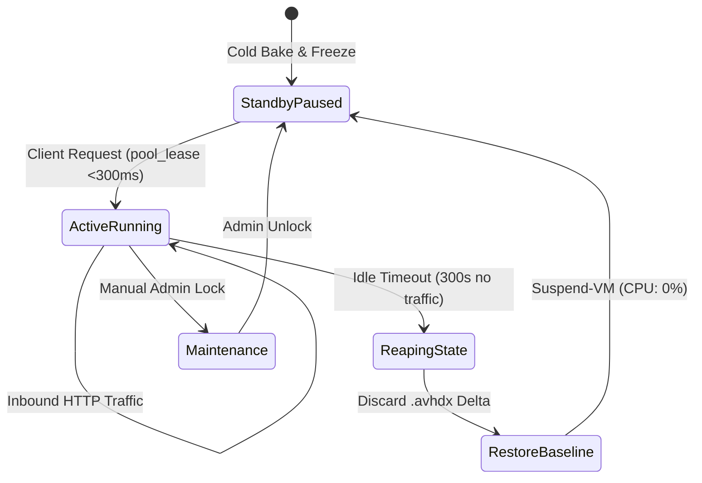
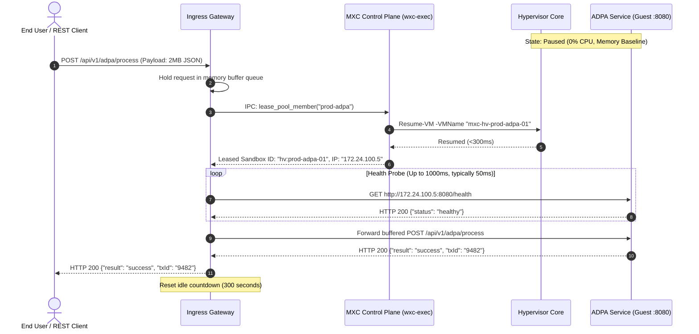

# Pillar III: Functional Design Document (FDD)
## Just-in-Time (JIT) Scale-to-Zero Production Hyper-V Sandboxes (ADPA / SIDPA)

---

## 1. System Architecture & Subsystem Decomposition

```
┌────────────────────────────────────────────────────────────────────────┐
│                        MXC Production Subsystems                       │
├───────────────────┬───────────────────┬────────────────────────────────┤
│ 1. Ingress Proxy  │ 2. Lifecycle      │ 3. Guest Production Appliance  │
│    Gateway        │    Controller     │    (ADPA / SIDPA)              │
│ - Buffer Queue    │ - Warm Pool Mgr   │ - Production Windows Service   │
│ - Wake Signal IPC │ - Inactivity Reap │ - Health Probe (:8080/health)  │
│ - Health Poller   │ - Differencing    │ - Internal Isolated Virtual NIC│
│ - Session Tracker │   Disk Discard    │ - Memory-Resident Working Set  │
└───────────────────┴───────────────────┴────────────────────────────────┘
```

---

## 2. Component Specifications

### 2.1 Component 1: JIT Ingress Proxy Gateway
* **Technology**: Reverse Proxy Engine (YARP / Envoy / FastMCP Gateway) running as a system service on the Hyper-V host or DMZ node.
* **Responsibilities**:
  1. Terminate client TLS connections (`:443`).
  2. Match incoming request paths to production pool targets (e.g., `/api/v1/adpa/*` ➔ `pool:prod-adpa`).
  3. Maintain a buffered connection queue while instances are dormant.
  4. Dispatch synchronous wake commands (`pool_lease`) to the MXC lifecycle controller.
  5. Poll guest health endpoint (`:8080/health`), proxy HTTP requests, and stream responses back to the client.
  6. Reset session inactivity timers on each transmitted packet.

* **Proxy Route Configuration Schema**:
  ```json
  {
    "route_id": "adpa_production_service",
    "match_path": "/api/v1/adpa/{**catch-all}",
    "target_pool": "prod-adpa",
    "guest_port": 8080,
    "wake_timeout_ms": 3000,
    "idle_timeout_seconds": 300,
    "health_check_path": "/health"
  }
  ```

> [!TIP]
> **Future Horizon & Scaling Enhancement (Component 1): Intelligent Circuit-Breaking & Surge Rate-Limiting**  
> Add adaptive token-bucket rate limiting and circuit-breaking at the Ingress Gateway level to protect waking pools from DDoS amplification attacks or thundering-herd webhook storms during traffic spikes.

---

### 2.2 Component 2: MXC Hardware Lifecycle Controller (`wxc-exec`)
* **Technology**: Native Rust Hyper-V Backend (`src/mxc-sdk/src/backends/hyperv/`) with cross-process atomic locking (`TransitionLock`).
* **Responsibilities**:
  1. Maintain durable pool state in `%ProgramData%\mxc\hyperv\pool\pool_state.json`.
  2. Execute sub-300ms `pool-lease` operations using hypervisor `Resume-VM`.
  3. Execute `pool-release` operations: disconnect external adapters, restore `baseline-hot-ready` checkpoint, discard delta differencing disk (`.avhdx`), and suspend VM via `Suspend-VM`.
  4. Provide FastMCP / REST telemetry on instance state, CPU, RAM, and uptime.

* **Lifecycle State Machine**:



> [!TIP]
> **Future Horizon & Scaling Enhancement (Component 2): Adaptive Idle Timeout Analytics**  
> Replace static 300-second timers with adaptive inactivity thresholds driven by workload telemetry—keeping interactive multi-step workflow sessions warm longer while aggressively reclaiming single-shot webhook instances within 30 seconds.

---

### 2.3 Component 3: Guest Production Appliance & Image Baking Pipeline (ADPA / SIDPA)
* **Operating System**: Windows Server 2025 Core or Hardened Desktop Experience (`winserv2025-prod-adpa.vhdx`).
* **Pre-Baking Pipeline & Configuration**:
  * **Artifact Injection**: CI/CD compiles release binaries for ADPA / SIDPA and mounts a clean Windows Server 2025 VHDX template to inject the encrypted bundle.
  * **Service Architecture**: Application runs as a self-hosted Windows Service (Kestrel / FastAPI / Go service) listening on internal interface `0.0.0.0:8080`.
  * **Health Check Endpoint**: `GET /health` returns JSON `{"status": "healthy", "service": "ADPA", "uptime_ms": 1240}` in $<5\text{ms}$.
  * **Memory Optimization**: Assemblies pre-compiled (Native AOT or NGen). Working set memory warmed via synthetic smoke test before taking the golden baseline checkpoint (`baseline-hot-ready`).
  * **Security Profile**: Windows Firewall blocks all inbound traffic except port `8080` from the host internal virtual switch. All outbound internet traffic is blocked by default (`mxc-net-disable` airgap mode).

> [!TIP]
> **Future Horizon & Scaling Enhancement (Component 3): Zero-Downtime Rolling VHDX Updates**  
> Implement a rolling baseline promotion pipeline that registers newly baked production VHDX images into the standby pool alongside active sessions, seamlessly draining older baseline VMs upon idle timeout without dropping a single in-flight client connection.

---

## 3. Protocol & Execution Sequence (Wake-on-Request)



---

## 4. Automated Reaping & Baseline Reset Protocol

1. **Inactivity Detection**:
   * The Ingress Gateway records the timestamp of the last transmitted HTTP packet for `hv:prod-adpa-01`.
   * When elapsed time $> \text{idle\_timeout\_seconds}$ (default: $300\text{s}$), reaping is triggered.
2. **Rollback Execution**:
   * Ingress Proxy issues `pool_release("hv:prod-adpa-01")`.
   * MXC executes the deterministic rollback protocol:
     1. Disconnects external network adapters (verifying strict airgap).
     2. Restores the VM to the named checkpoint `baseline-hot-ready`.
     3. Deletes the active child differencing disk (`.avhdx`).
     4. Resynchronizes clock state and invokes `Suspend-VM` to place the VM in a zero-CPU Paused state.
     5. Marks the instance as `ready` in `pool_state.json`.
