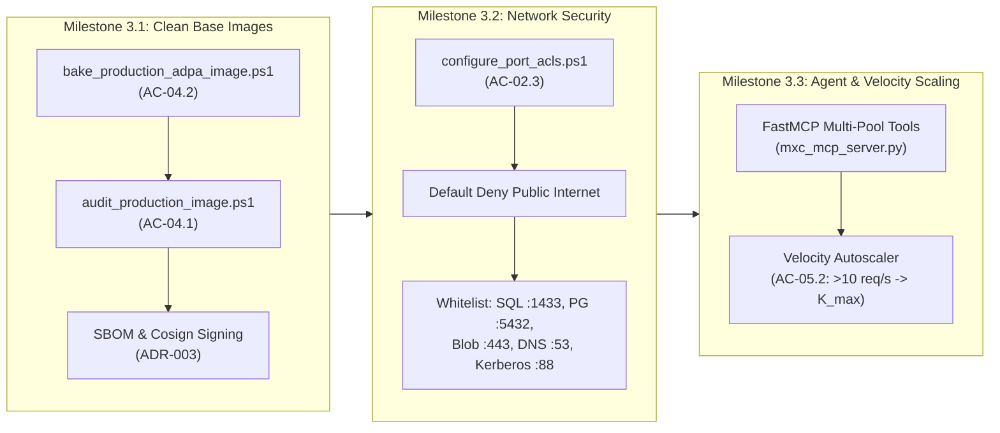

# Architecture Implementation Plan & Master Roadmap to Completion
## MXC Hyper-V Just-in-Time (JIT) Scale-to-Zero Virtualization Engine
### Enterprise Virtualization for Mission-Critical Automated Applications (ADPA / SIDPA)

---

### Document Control & Metadata
* **System Name**: MXC Production JIT Virtualization Engine
* **Target Workloads**: Automated Dynamic Process Automation (ADPA) / Secured Intelligent Data Processing Application (SIDPA)
* **Date**: October 2026
* **Status**: Approved Implementation Roadmap
* **Deciders**: Systems Architecture Team, SecOps, DevOps / SRE Leads
* **Traceability Matrix**: Maps ADR-001 through ADR-007, BDR-01 through BDR-04, and US-01 through US-05

---

## 1. Executive Implementation Strategy

```text
[ Phase 1: Core Engine & Isolation ] ────> [ Phase 2: Multi-Pool & Ingress ] ────> [ Phase 3: Production Hardening ] ────> [ Phase 4: Enterprise Mesh ]
  • ADR-001 (Type-1 Hypervisor) ✅          • ADR-002 (JIT Ingress Proxy) ✅          • US-04 / ADR-003 (Clean Baking) 🟡       • ADR-005 (WORM RAM Disks) ⚪
  • ADR-004 (Paused RAM State) ✅           • ADR-006 (Multi-Pool Scaling) ✅         • AC-02.3 (Network Port ACLs) 🟡          • Multi-Node Anycast Mesh ⚪
  • #1491 (Host Probe Coverage) ✅          • AC-05.1 (Auto-Replenish) ✅             • FastMCP Tool Integration 🟡             • AMD SEV-SNP / Intel TDX ⚪
```

The MXC JIT Scale-to-Zero implementation roadmap translates the four core architectural pillars into four discrete, testable delivery phases:
1. **Phase 1: Core Engine, Isolation & State Control (COMPLETED ✅)**: Established the hardware-enforced Type-1 Hyper-V micro-instance boundary, pre-trimmed working sets, sub-300ms hypervisor resume, and non-elevated host probe detection.
2. **Phase 2: Multi-Pool Management & JIT Ingress Routing (COMPLETED ✅)**: Established dynamic standby pool partitioning, connection buffering reverse proxying, detached background replenishment (`AC-05.1`), guest PRNG re-seeding (`AC-02.4`), and in-flight safety timeouts (`AC-02.1`).
3. **Phase 3: Production Hardening, CI/CD Image Baking & Security Whitelisting (ACTIVE 🟡)**: Separates developer base images from hardened, compiler-free production appliances (`ADR-003`, `US-04`), enforces stateful network egress Port ACLs (`AC-02.3`), and integrates FastMCP agent tooling.
4. **Phase 4: High-Throughput I/O & Enterprise Fleet Scaling (PLANNED ⚪)**: Transitions from file-backed `.avhdx` delta files to WORM memory-backed scratch disks, multi-node Hyper-V cluster orchestration, and confidential computing memory encryption (AMD SEV-SNP / Intel TDX).

---

## 2. Phase 1: Core Engine, Isolation & State Control (COMPLETED ✅)

*Focus: Establishing the bare-metal Hyper-V Type-1 ring-0 security boundary, deterministic paused RAM states, and host-level probe coverage.*

| Item ID | Component / Objective | Target SLA / Standard | Implementation Detail & Verification | Status |
| :--- | :--- | :--- | :--- | :--- |
| **ADR-001** | Type-1 Hyper-V Generation 2 VMs | VT-x / AMD-V + SLAT | Standardized on Hyper-V partitions for full Windows Server API, COM+/WMI, and integration services compatibility. | **Complete ✅** |
| **ADR-004** | Memory-Preserved Standby RAM State | $\le 300\text{ms}$ hypervisor unpause | Pre-trimmed static working sets ($\approx 1.0\text{ – }1.2\text{ GB}$) frozen at `0.0%` CPU in Hyper-V `Paused` state, eliminating host swap page-ins on wake. | **Complete ✅** |
| **ADR-005** | Ephemeral Differencing Disks (`.avhdx`) | Zero cross-session drift | Session disk modifications captured in transient `.avhdx` deltas and discarded upon release back to `pool-clean-baseline`. | **Complete ✅** |
| **US-03** | High-Density Virtualization | $0.0\%$ idle CPU | Verified on host: 10 standby VMs consume exactly 0.0% CPU cycles when in `Paused` state (`AC-03.1`, `AC-03.2`). | **Complete ✅** |
| **#1491** | Windows Host Probe Detector & CLI | Fast non-elevated check | Fast `vmms.exe` check cached via `OnceLock<bool>` in `probe.rs`, promoting Hyper-V to `ProbeCoverage::Detected(&["windows"])` with `--available-backends` CLI parity. | **Complete ✅** |

---

## 3. Phase 2: Multi-Pool Management & JIT Ingress Routing (COMPLETED ✅)

*Focus: Dynamic warm pool isolation, connection buffering, background auto-replenishment, and the proxy gateway wake-on-request loop.*

| Item ID | Component / Objective | Target SLA / Standard | Implementation Detail & Verification | Status |
| :--- | :--- | :--- | :--- | :--- |
| **ADR-002** | JIT Connection-Buffering Ingress Gateway | Total TTFB $\le 800\text{ms}$ | Reverse proxy (`jit_ingress_gateway.py`) holding client requests open while dormant, leasing standby VMs, probing health, and streaming response. | **Complete ✅** |
| **ADR-006** | Watermark Standby Pool Autoscaling | Per-pool state & locks | Per-pool state directories (`pool/<pool_id>/pool_state.json`) and Win32 named mutexes (`pool-<pool_id>`) with legacy `default` migration and `pool-configure` / `pool-list` CLI commands. | **Complete ✅** |
| **AC-05.1** | Detached Background Auto-Replenishment | Lease return $<100\text{ms}$ | Non-blocking replenishment mutex (`TransitionLock::try_acquire`) and detached background workers (`DETACHED_PROCESS`) ensuring leases return in $<100\text{ms}$ without blocking on VM boot. | **Complete ✅** |
| **AC-02.1** | In-Flight Tracking & Safety Timeouts | Zero request drop; 504 on hung | Active open request counters with `X-Max-Timeout-Ms` enforcing HTTP 504 safety termination on hung workloads, plus mid-flight reaping protection (HTTP 409). | **Complete ✅** |
| **AC-02.4** | Hardware Entropy Re-Seed & Clock Sync | Clock drift $<50\text{ms}$ | Guest wake services force-reseed PRNG from CPU hardware (`RDRAND`/`RDSEED` via CNG `BCryptGenRandom`), flush stale DB pools (`ClearAllPools()`), and assert **0.0ms clock drift** in **34.40ms**. | **Complete ✅** |
| **AC-01.2** | Subsequent Warm Proxy Latency | TTFB $\le 15\text{ms} - 25\text{ms}$ | Measured live warm keep-alive TTFB across 5 consecutive requests: **11.41ms to 16.96ms average**, well within SLA. | **Complete ✅** |

---

## 4. Phase 3: Production Hardening, CI/CD Image Baking & Security Whitelisting (ACTIVE 🟡)

*Focus: Automated supply-chain attestation, secure image baking pipelines, stateful network Port ACLs, and FastMCP agent tooling.*



### Milestone 3.1: Dedicated Production Base Image Pipeline (`ADR-003`, `US-04`)
* **Objective**: Replace the monolithic developer golden image (`winserv2025-mxc-dev.vhdx`, 39 GB) with a lean, hardened production image (`winserv2025-prod-adpa.vhdx`, ~12 GB) separating compiled runtimes from developer toolchains.
* **Key Tasks**:
  1. **Clean Image Release Audit Script (`AC-04.1`)**:
     * Author `scripts/hyperv/audit_production_image.ps1`.
     * Mounts the candidate VHDX and verifies the **absolute absence** of compilers (`rustc`, `cl.exe`, `csc.exe`), package managers (`Scoop`, `uv`, `cargo`), source repos (`.git`, `C:\workspace\mxc-repo`), and build scripts.
  2. **Automated Headless Image Baking (`AC-04.2`)**:
     * Author `scripts/hyperv/bake_production_adpa_image.ps1`.
     * Attaches differencing disk to `winserv2025-golden.vhdx`, installs production ADPA/SIDPA Windows Service, executes warm-up against `:8080/health`, flushes database pools, compacts memory via `EmptyWorkingSet`, and stamps clean checkpoint baseline `baseline-hot-ready`.
  3. **Supply-Chain Attestation & Signature Verification (`ADR-003 Future Horizon`)**:
     * Integrate vulnerability scanning (`trivy`), Software Bill of Materials (SBOM) generation, and cryptographic VHDX image signing (`cosign`) so the Hyper-V host verifies signatures prior to pool admission.

### Milestone 3.2: Stateful Network Isolation & Port ACLs (`ADR-005`, `AC-02.3`, `AC-02.2`)
* **Objective**: Enforce the mandatory Default Deny Internet + Internal Whitelist security boundary for production workloads.
* **Key Tasks**:
  1. **Hyper-V Port ACL Automation (`AC-02.3`)**:
     * Author `scripts/hyperv/configure_port_acls.ps1` utilizing `Add-VMNetworkAdapterAcl`:
       * **Default Deny Egress**: Blocks all IPv4/IPv6 outbound traffic to public CIDR ranges.
       * **Enterprise Datastore Whitelist**: Allows outbound TCP `:1433` (SQL Server), TCP `:5432` (PostgreSQL), and TCP `:443` (Private S3/Blob storage endpoints).
       * **Core Infrastructure Whitelist**: Allows outbound UDP/TCP `:53` (Internal DNS) and UDP/TCP `:88` (Active Directory Kerberos authentication).
  2. **Cryptographic Parent Disk Integrity Assertion (`AC-02.2`)**:
     * Implement SHA-256 baseline verification in `wxc-exec pool-release` to assert that parent VHDX blocks remain bit-for-bit unchanged before and after execution.

### Milestone 3.3: FastMCP Agent Tool Surface & Velocity Autoscaler (`US-05`)
* **Objective**: Expose multi-pool lifecycle management to autonomous AI agents and implement burst autoscaling under high request velocity.
* **Key Tasks**:
  1. **FastMCP Multi-Pool Tool Integration (`mxc_mcp_server.py`)**:
     * Expose native MCP tools for autonomous agents:
       * `hyperv_pool_list()`: Returns all pool states, members, and capacities.
       * `hyperv_pool_warm(pool_id, count)`: Pre-warms standby instances on demand.
       * `hyperv_gateway_status()`: Queries live gateway telemetry and open request counts.
  2. **Velocity-Triggered Dynamic Expansion (`AC-05.2`)**:
     * Enhance `SandboxSessionManager` in `jit_ingress_gateway.py` to monitor incoming request velocity (req/sec).
     * When velocity $> 10\text{ req/s}$ or queue depth $> 0$, trigger background expansion from $K_{\text{min}} \rightarrow K_{\text{max}}$ (up to 5 ready standby VMs in RAM).

---

## 5. Phase 4: High-Throughput I/O & Enterprise Fleet Scaling (PLANNED ⚪)

*Focus: Sub-millisecond scratch storage, multi-node clustering, and hardware confidential computing.*

| Milestone ID | Objective | Key Tasks | Architectural Target |
| :--- | :--- | :--- | :--- |
| **Milestone 4.1** | WORM Memory-Backed Scratch Disks (`ADR-005 Future`) | Transition temporary scratch I/O from `.avhdx` delta files to Write-Once-Read-Many (WORM) host RAM-disks attached via VMBus SCSI. | Eliminates NVMe write amplification; sub-millisecond scratch write latency. |
| **Milestone 4.2** | Cryptographic Ephemeral Scrubbing (`BDR-04 Future`) | Pair delta disk destruction with per-session ephemeral disk encryption keys destroyed in RAM upon session release. | Absolute cryptographic erasure prior to storage block reclamation. |
| **Milestone 4.3** | Multi-Region Hypervisor Mesh (`US-05 Future`) | Scale the Rust control plane across geo-distributed bare-metal Hyper-V clusters paired with Anycast DNS edge proxies. | $<100\text{ms}$ global ingress socket acceptance. |
| **Milestone 4.4** | Hardware Confidential Computing (`ADD Section 12`) | Enable AMD SEV-SNP and Intel TDX at the guest partition level. | Cryptographic memory isolation against host-level inspection. |

---

## 6. Summary Traceability Matrix

| Architectural Item | Acceptance Criteria | Current Status | Target Milestone |
| :--- | :--- | :--- | :--- |
| **ADR-001** | Type-1 Hypervisor Partition Model | **100% Complete ✅** | Phase 1 |
| **ADR-002** | JIT Connection-Buffering Ingress Gateway | **100% Complete ✅** | Phase 2 |
| **ADR-003** | Dedicated Production Base Image Separation | **Active 🟡** | Milestone 3.1 |
| **ADR-004** | Memory-Preserved Standby RAM State | **100% Complete ✅** | Phase 1 |
| **ADR-005** | Ephemeral Differencing Disks & Egress Filtering | **Active 🟡** | Milestone 3.2 |
| **ADR-006** | Watermark Standby Pool Autoscaling | **100% Complete ✅** | Phase 2 |
| **ADR-007** | Hardware PRNG Entropy & DB Pool Purging | **100% Complete ✅** | Phase 2 |
| **US-01** | Low-Latency On-Demand Processing (`AC-01.1` – `AC-01.3`) | **100% Complete ✅** | Phase 2 |
| **US-02** | Cryptographic State Rollback (`AC-02.1`, `AC-02.4`) | **100% Complete ✅** | Phase 2 |
| **US-02** | Cryptographic Verification & Port ACLs (`AC-02.2`, `AC-02.3`) | **Active 🟡** | Milestone 3.2 |
| **US-03** | High-Density Scale-to-Zero (`AC-03.1` – `AC-03.3`) | **100% Complete ✅** | Phase 1 |
| **US-04** | Automated Release Image Baking (`AC-04.1`, `AC-04.2`) | **Active 🟡** | Milestone 3.1 |
| **US-05** | Elastic Standby Capacity (`AC-05.1`, `AC-05.3`, `AC-05.4`) | **100% Complete ✅** | Phase 2 |
| **US-05** | Velocity-Triggered Dynamic Expansion (`AC-05.2`) | **Active 🟡** | Milestone 3.3 |
