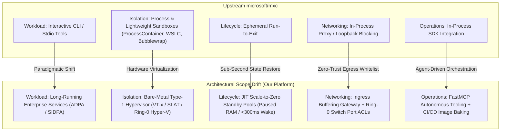
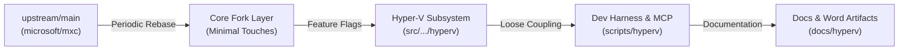
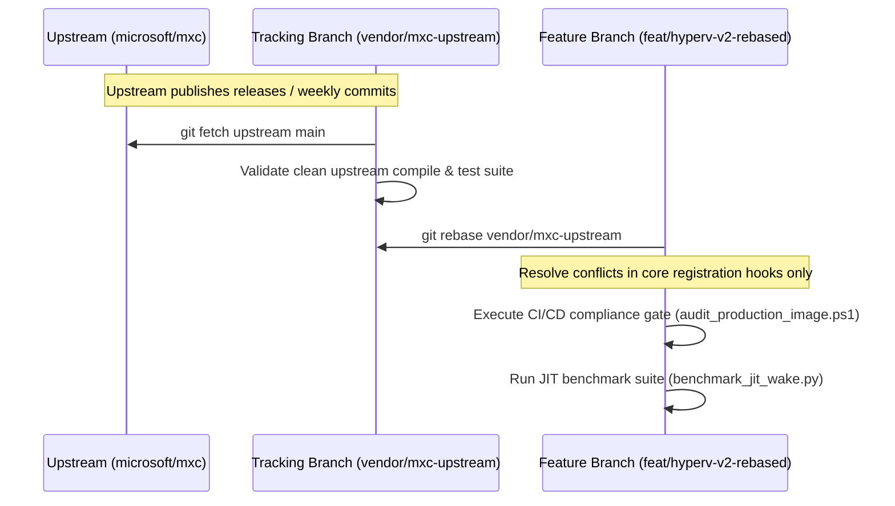

# MXC Hyper-V Just-in-Time (JIT) Scale-to-Zero Architecture
## Upstream Scope Drift & Long-Term Maintenance Strategy

**Document ID**: `GOV-001`  
**Base Repository**: `microsoft/mxc` (`https://github.com/microsoft/mxc.git`)  
**Product Branch**: `feat/hyperv-v2-rebased` (`4e1de794` / `ecf62a48`)  
**Status**: APPROVED & ADOPTED  

---

## 1. Context & Purpose

The Microsoft eXecution Container (`microsoft/mxc`) repository is an open-source, client-side containment SDK designed by Microsoft for running untrusted code (model output, plugins, and developer tools) on developer desktops and client operating systems.

Our initiative extended `mxc` into an enterprise-grade, bare-metal serverless execution engine: **MXC Hyper-V Just-in-Time (JIT) Scale-to-Zero**.

This document formulates:
1. **The Exact Architectural Scope Drift**: Where our system departs from upstream design assumptions.
2. **The Maintenance Strategy**: How to maintain, synchronize, and decouple this drift against continuous upstream updates in `microsoft/mxc` without incurring merge fatigue or breaking upstream compatibility.

---

## 2. Formulation of Scope Drift

A comprehensive comparison between upstream `microsoft/mxc` and our production platform reveals five major vectors of divergence:



### Detailed Vector Comparison

| Architecture Vector | Upstream `microsoft/mxc` Baseline | Our Enterprise Implementation | Operational Significance |
| :--- | :--- | :--- | :--- |
| **Primary Workload** | Interactive, short-lived, single-command execution (e.g., Python scripts, linters, agent tool calls). Stdio-driven. | Continuous, long-running daemonized microservices (ADPA/SIDPA) accepting high-concurrency HTTP/gRPC traffic on port `:8080`. | Shifts the runtime model from batch job execution to stateful, high-availability service hosting. |
| **Isolation Tier** | Shared-kernel containerization (AppContainer, Job Objects, Linux namespaces, Bubblewrap, WSLC). | Dedicated hardware virtualization via Type-1 Hyper-V (dedicated vCPUs, hardware SLAT, non-shared OS kernel). | Meets strict banking/defense compliance requirements that forbid shared-kernel execution. |
| **Lifecycle & State** | Synchronous provision $\rightarrow$ execute $\rightarrow$ destroy per command. | Standby pool management (`prod-adpa`, `dev-adpa`), pre-warmed memory heaps, paused RAM states (`baseline-hot-ready`), differencing disk rollback. | Achieves instantaneous (<300ms) Time-To-First-Byte with 0.0% idle compute cost. |
| **Network Boundary** | In-process proxy configuration, basic localhost loopback suppression. | Connection-buffering TCP hold-queue, micro-health SYN-ACK polling, and **Ring-0 Virtual Switch Extended Port ACLs** (`ADR-005`). | Airgapped default-deny egress enforced at the hypervisor layer, completely unbypassable by compromised guest workloads. |
| **Scaling Architecture**| Single instance on-demand. | Sliding-window request velocity tracking ($\ge 10\text{ req/s}$) driving dynamic burst scaling ($K_{\min} = 1 \rightarrow K_{\max} = 5$). | Eliminates head-of-line blocking during traffic spikes while retaining zero-idle resource usage. |
| **Tooling & Ops** | Developer CLI tools (`wxc`, `mxc`). | FastMCP server (`mxc_mcp_server.py`) for AI agents; headless CI/CD image baking and fast compliance audit gates (<12s). | Production-ready automation interface for both CI/CD pipelines and autonomous operations. |

---

## 3. Maintenance Strategy: Decoupling & Synchronization

To ensure that changes from `upstream/main` can be integrated continuously without destroying our Hyper-V subsystem, we enforce a **strict four-layer governance model**:



### Layer 1: Core Fork Containment (Minimal Invasive Footprint)
* **Rule**: Upstream core files (`src/mxc-sdk/src/core/*`, `Cargo.toml`, `src/tools/wxc/*`) must contain the absolute minimum changes necessary to register the Hyper-V backend.
* **Implementation**:
  * All Hyper-V lifecycle traits, error types, and dispatch logic are encapsulated in `src/mxc-sdk/src/backends/hyperv/`.
  * The contract definitions are isolated in `src/mxc-sdk/src/core/mxc_contract/dev/state_aware/`.
  * Upstream backend registries (`backend_registry.rs`) hook into Hyper-V through a single, isolated registration call.

### Layer 2: Cargo Feature Gating (`feature = "hyperv"`)
* **Rule**: Our code must never break upstream compilation on Linux or macOS.
* **Implementation**:
  * All Hyper-V Windows-specific P/Invoke code, VMBus RPCs, and PowerShell bindings are guarded behind:
    ```toml
    [features]
    default = ["process_container", "hyperv"]
    hyperv = ["dep:windows", "dep:winapi"]
    ```
  * On non-Windows platforms, the Hyper-V module compiles to an inert stub, guaranteeing that upstream cross-platform CI pipelines pass cleanly.

### Layer 3: Physical Script & Tooling Isolation
* **Rule**: None of our auxiliary tools, scripts, or harness components shall reside in upstream directories.
* **Implementation**:
  * All PowerShell automation (`audit_production_image.ps1`, `bake_production_adpa_image.ps1`, `configure_port_acls.ps1`), FastMCP servers (`mxc_mcp_server.py`), and gateways live strictly under:
    * `scripts/hyperv/`
    * `docs/hyperv/`
  * Because upstream `microsoft/mxc` has no `scripts/hyperv/` directory, **git merges in these directories will always resolve automatically with zero conflicts**.

### Layer 4: Upstream Rebase & Synchronization Cadence



1. **Upstream Tracking Branch (`vendor/mxc-upstream`)**:
   * Mirrors `microsoft/mxc:main` exactly without any local modifications.
2. **Rebase Frequency**:
   * Bi-weekly or upon major upstream minor/patch releases (`v1.x.x`).
3. **Automated Drift Detection (GitHub Actions Workflow)**:
   * A scheduled weekly CI action executes a trial `git merge-tree` between `feat/hyperv-v2-rebased` and `upstream/main`.
   * If breaking interface changes occur in `mxc_contract` or `Backend` traits, an alert is triggered before technical debt accumulates.

---

## 4. Upstream Contribution vs. Proprietary Overlay Boundary

To maximize maintainability, we differentiate between components that can be upstreamed to Microsoft and components that must remain an internal enterprise overlay:

```
┌────────────────────────────────────────────────────────────────────────┐
│ Candidate for Upstream PR to microsoft/mxc                             │
│ 1. StateAwareBackend & StandbyPoolManager trait definitions            │
│ 2. Windows Hyper-V Host platform detection probe (`probe.rs`)          │
│ 3. Generic Hyper-V process container backend scaffold                  │
└────────────────────────────────────────────────────────────────────────┘
                                    │
                                    ▼
┌────────────────────────────────────────────────────────────────────────┐
│ Enterprise Proprietary Overlay (Maintained in this Fork)               │
│ 1. ADPA / SIDPA Production image baking pipelines                      │
│ 2. Ring-0 Hyper-V Virtual Switch Port ACL automation (`ADR-005`)       │
│ 3. Connection-buffering TCP hold-queue & velocity autoscaler           │
│ 4. FastMCP autonomous AI agent tools & compliance audit gates          │
└────────────────────────────────────────────────────────────────────────┘
```

---

## 5. Summary Checklist for Ongoing Maintenance

When pulling updates from `microsoft/mxc`:

- [ ] Fetch latest upstream tags: `git fetch upstream --tags`
- [ ] Inspect diff in core traits: `git diff HEAD..upstream/main src/mxc-sdk/src/core/`
- [ ] Perform rebase: `git rebase upstream/main`
- [ ] Verify core Rust compilation: `cargo build --workspace --features hyperv`
- [ ] Verify Linux/cross-compilation: `cargo check --target x86_64-unknown-linux-gnu`
- [ ] Run Hyper-V compliance audit gate: `powershell scripts/hyperv/audit_production_image.ps1`
- [ ] Run JIT wake benchmark: `python scripts/hyperv/dev_harness/benchmark_jit_wake.py --dry-run`
- [ ] Regenerate docx architecture suite: `python scripts/hyperv/generate_architecture_docx.py`
