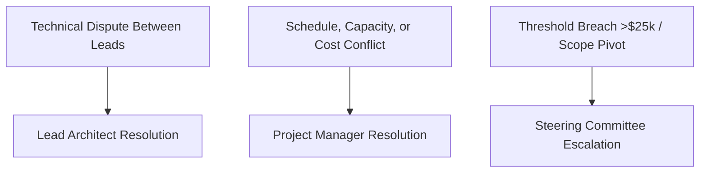

# Communications Management Plan — MXC Hyper-V for ADPA / SIDPA

**Status:** Approved. Formally approved by Menno Drescher (Project Sponsor / Project Manager) on 2026-11-20 under `approve-pmp`. Establishes the communication flows, reporting cadence, and telemetry reporting for the hybrid human-agent operating model.

## 1. Communication matrix and information flows

Communication in MXC bridges autonomous agent workers, technical engineering leads, project leadership, and executive governance:

| Information deliverable | Target audience | Transmission channel / tool | Frequency / trigger | Accountable owner | Content summary |
|---|---|---|---|---|---|
| **Story Task Claim & Status** | Agent Workers & Leads | `docs/registers/Story-Execution-Register.md` | Real-time on pickup/completion | Dev Coordinator | Worker ID, branch name, story ID, timestamp, gate status. |
| **PR Verification Telemetry** | Engineering Leads & QA | Git PR comment via `scripts/pr_gate.py` | Per pull request | Agent Worker / QA | Test pass rates, code critique score, rubric evaluation. |
| **Execution Wave Progress** | Project Manager & Leads | Project status log / Git milestone tracker | Weekly / Wave boundary | Project Manager | Burn-down of activities, float consumption, milestone health. |
| **Cost & EVM Variance Report** | PM & Finance Controller | EVM tracking log in `Cost-Variance-Protocol.md` | Bi-weekly | Project Manager | Planned Value ($PV$), Earned Value ($EV$), Actual Cost ($AC$), $CPI$. |
| **Threshold Escalation Notice** | Steering Committee | Formal decision memorandum / email | Event-driven ($> \$25\text{k}$ or scope pivot) | Project Sponsor (Menno) | Business Case amendment, variance root cause, proposed action. |
| **Operational Benefit Proof** | Sponsor & Benefit Owners | Phase 1 Acceptance Report / `Benefits-Statement.md` | Milestone M5 completion | Test Coordinator | End-to-end multi-session proof of all 12 Charter benefits. |

---

## 2. Communications channels and repository as durable source of truth

1. **Durable Source of Truth**:
   - The git repository (`c:\Users\MennoDrescher\source\repos\mxc`) is the sole durable record for all approved baselines, architecture decisions, requirements, gate results, and test evidence.
   - Informal chat, draft notes, or intermediate model responses do not constitute project authorization.
2. **Traceable References**:
   - Every status report, PR, and decision record must explicitly reference the affected artifact ID, version, and WBS code (e.g. `WBS 2.1`, `Story 1.1`, `PMP-BL-v1.0.0`).

---

## 3. Conflict resolution and escalation communication path

- **Level 1 (Technical & Architecture)**: Resolved within 24 hours by the Lead / System Architect.
- **Level 2 (Schedule, Resourcing & Budget $\le \$25,000$)**: Resolved within 48 hours by the Project Manager.
- **Level 3 (Charter Boundaries, External Policy, Spending $> \$25,000$)**: Formally escalated to the Steering Committee for decision.
