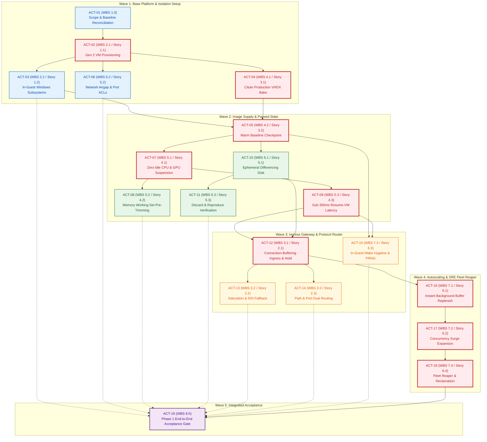

# Schedule Network — MXC Hyper-V for ADPA / SIDPA

**Status:** Draft for review. Decomposed for asynchronous agentic workers to pick up tasks autonomously across non-blocking concurrency waves.

## 1. Network diagram (WBS activity dependency graph)

The following Mermaid diagram maps all activities (`ACT-01` through `ACT-19`) decomposed from WBS packages 1.0 through 8.0 (Stories 1.1–6.4). The bold red/accent stroke highlights the **Critical Path**:

---

## 2. Predecessor and successor logic table

| Predecessor | Successor | Relationship / lag | Rationale / source | Validated by |
|---|---|---|---|---|
| **ACT-01** (WBS 1.0) | **ACT-02** (WBS 2.1) | FS + 0d | Baseline scope & WBS reconciliation must be locked before VM provisioning automation starts. | `approve-pmp` verification check |
| **ACT-02** (WBS 2.1) | **ACT-03** (WBS 2.2) | FS + 0d | In-guest Windows subsystems require a provisioned Gen 2 VM shell. | `tests/test_vm_provisioning.py` |
| **ACT-02** (WBS 2.1) | **ACT-04** (WBS 4.1) | FS + 0d | VHDX bake pipeline requires VM definition parameters (Gen 2 UEFI, virtual hardware spec). | PowerShell bake smoke test |
| **ACT-02** (WBS 2.1) | **ACT-06** (WBS 6.2) | FS + 0d | Virtual switch port ACLs require hypervisor vSwitch and VM NIC interfaces. | Port ACL unit tests |
| **ACT-03** (WBS 2.2) | **ACT-05** (WBS 4.2) | FS + 0d | Warm baseline checkpoint requires in-guest runtime subsystems to be validated healthy. | Subsystem health probe |
| **ACT-04** (WBS 4.1) | **ACT-05** (WBS 4.2) | FS + 0d | Checkpoint must be captured from the clean production VHDX image (no dev tooling). | Image audit report |
| **ACT-05** (WBS 4.2) | **ACT-07** (WBS 5.1) | FS + 0d | Suspension monitoring requires an established warm baseline VM instance. | `Suspend-VM` smoke probe |
| **ACT-05** (WBS 4.2) | **ACT-10** (WBS 6.1) | FS + 0d | Ephemeral differencing disk attaches to the base VHDX from ACT-05. | Differencing disk mount test |
| **ACT-05** (WBS 4.2) | **ACT-15** (WBS 7.3) | FS + 0d | Wake hygiene scripts require warm baseline state to test clock/PRNG unpause behaviors. | Guest agent unit test |
| **ACT-07** (WBS 5.1) | **ACT-08** (WBS 5.2) | FS + 0d | Working-set RAM trimming operates on VMs confirmed in suspended quiescence. | PerfMon RAM counter script |
| **ACT-07** (WBS 5.1) | **ACT-09** (WBS 5.3) | FS + 0d | Sub-300ms resume measurement measures transition out of verified suspension. | `Resume-VM` stopwatch benchmark |
| **ACT-10** (WBS 6.1) | **ACT-11** (WBS 6.3) | FS + 0d | Discard and reproduce verification requires working differencing disk automation. | Reproducibility test harness |
| **ACT-09** (WBS 5.3) | **ACT-12** (WBS 3.1) | FS + 0d | Ingress buffering TTFB budget ($\le 800\text{ms}$) depends directly on sub-300ms resume. | Ingress proxy integration test |
| **ACT-10** (WBS 6.1) | **ACT-12** (WBS 3.1) | FS + 0d | Ingress proxy must attach differencing disks dynamically on leasing guest. | Pool lease mount integration test |
| **ACT-09** (WBS 5.3) | **ACT-15** (WBS 7.3) | FS + 0d | In-guest wake hygiene executes during the resume window. | In-guest wake latency log |
| **ACT-12** (WBS 3.1) | **ACT-13** (WBS 3.2) | FS + 0d | Saturation fallback extends the core ingress reverse proxy when pool leases exhaust. | Saturation load test |
| **ACT-12** (WBS 3.1) | **ACT-14** (WBS 3.3) | FS + 0d | Dual routing rules build on the established reverse proxy listener. | Routing table test suite |
| **ACT-12** (WBS 3.1) | **ACT-16** (WBS 7.1) | FS + 0d | Buffer replenish triggers when the ingress router dispatches a pooled guest. | Pool lease listener event |
| **ACT-16** (WBS 7.1) | **ACT-17** (WBS 7.2) | FS + 0d | Dynamic surge expansion extends the single-lease replenishment loop. | Burst traffic generator |
| **ACT-17** (WBS 7.2) | **ACT-18** (WBS 7.4) | FS + 0d | Fleet reaper deallocates surge instances created by autoscaler. | Idle timeout reaper test |
| **ACT-18** (WBS 7.4) | **ACT-19** (WBS 8.0) | FS + 0d | Final Phase 1 acceptance requires full lifecycle (provision, pause, route, scale, reclaim). | `tests/test_e2e_phase1.py` |
| **ACT-03, 06, 08, 11, 13, 14, 15** | **ACT-19** (WBS 8.0) | FS + 0d | All parallel branch deliverables must pass their individual PR gates before acceptance roll-up. | Integrated acceptance suite |

---

## 3. Critical path analysis

The critical path determines the shortest calendar time required to deliver Phase 1:

$$\text{Critical Path} = \text{ACT-01} \longrightarrow \text{ACT-02} \longrightarrow \text{ACT-04} \longrightarrow \text{ACT-05} \longrightarrow \text{ACT-07} \longrightarrow \text{ACT-09} \longrightarrow \text{ACT-12} \longrightarrow \text{ACT-16} \longrightarrow \text{ACT-17} \longrightarrow \text{ACT-18} \longrightarrow \text{ACT-19}$$

### Path floats and parallel lanes

1. **Subsystem Validation Lane (`ACT-03`)**:
   - Predecessor: `ACT-02`; Successor: `ACT-05`.
   - Float: Runs concurrently with `ACT-04`. Total float = $\text{Duration}(\text{ACT-04}) - \text{Duration}(\text{ACT-03}) \approx 3.0\text{ hours}$.
2. **Network Airgap Lane (`ACT-06`)**:
   - Predecessor: `ACT-02`; Successor: `ACT-19`.
   - Float: Independent of state capture and ingress; total float $\approx 18.0\text{ hours}$. Security Worker can work fully asynchronously.
3. **Storage Hygiene Lane (`ACT-10`, `ACT-11`)**:
   - Predecessors: `ACT-05`; Successor: `ACT-12` (for `ACT-10`), `ACT-19` (for `ACT-11`).
   - Float: `ACT-10` runs parallel to `ACT-07` and `ACT-09`. Float = $\approx 2.5\text{ hours}$. `ACT-11` has $\approx 12.0\text{ hours}$ float.
4. **Memory Optimization Lane (`ACT-08`)**:
   - Predecessor: `ACT-07`; Successor: `ACT-19`.
   - Float: Parallel to `ACT-09`, `ACT-12`, and Wave 4; total float $\approx 14.0\text{ hours}$.
5. **Ingress Routing & Fallback Lanes (`ACT-13`, `ACT-14`)**:
   - Predecessor: `ACT-12`; Successor: `ACT-19`.
   - Float: Runs parallel to Wave 4 autoscaling; total float $\approx 8.0\text{ hours}$.
6. **In-Guest Wake Hygiene Lane (`ACT-15`)**:
   - Predecessor: `ACT-05`, `ACT-09`; Successor: `ACT-19`.
   - Float: Runs parallel to Wave 3 Ingress and Wave 4 Autoscaling; total float $\approx 10.0\text{ hours}$.

---

## 4. Asynchronous agent execution protocol

To enable autonomous agent workers (e.g., using `invoke_subagent` or swarm workers) to pick up tasks without collisions:

1. **Contract-Driven Work Claim**:
   - Before modifying files, an agent reads [Schedule-Activity-List-Phase1.md](Schedule-Activity-List-Phase1.md) and claims the activity in `docs/registers/Story-Execution-Register.md` (recording Worker ID, Timestamp, Branch Name `feat/story-<num>`).
2. **Pre-Flight Invariant Check**:
   - Run `python scripts/spec_gate.py --story <id>`. If dependencies are incomplete, the agent terminates cleanly and awaits predecessor completion.
3. **Workspace Isolation**:
   - Subagents run in isolated workspaces (`workspace: "share"` or `workspace: "branch"`) to prevent uncommitted working directory collisions.
4. **Completion & Gate Handoff**:
   - Upon completing the implementation, the agent runs local unit tests.
   - The agent executes `python scripts/pr_gate.py --pr <pr_num>`.
   - When verified, the agent updates the status in `docs/registers/Story-Execution-Register.md`, unblocking downstream activities in the network.
