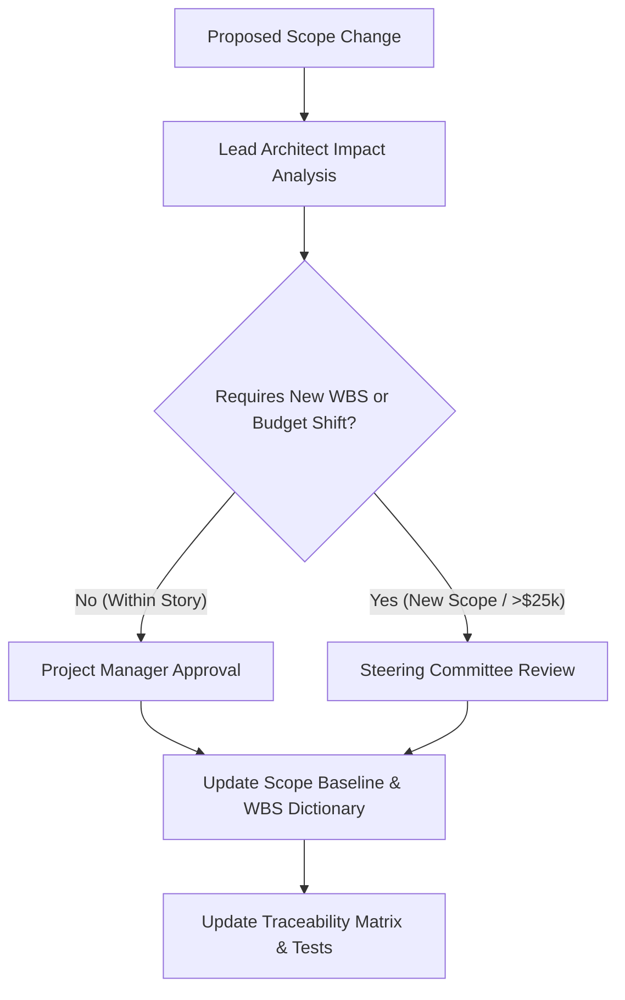

# Monitor and Control Scope — MXC Hyper-V for ADPA / SIDPA

**Status:** Draft — Ready for Review. Defines scope variance thresholds, change control workflows, and traceability auditing protocols.

## 1. Scope performance measurement and variance control

Scope performance is tracked by comparing deliverables committed on story branches against the approved WBS Dictionary and user story specifications:

| Scope performance measure | Target baseline | Measurement tool | Review cadence | Variance tolerance threshold | Corrective action |
|---|---|---|---|---|---|
| **WBS Work Package Adherence** | 17 approved User Stories across WBS 1.0–8.0 | `python scripts/spec_gate.py` | Per story claim | Zero unauthorized work packages | Halt unapproved branch; revert out-of-scope code. |
| **Acceptance Criteria Pass Rate** | 100% of BDD scenarios passing | `python scripts/pr_gate.py` | Per pull request | Zero failing acceptance scenarios | Agent attempts repair turns; escalate to lead triage if unresolved. |
| **Pillar Scope Boundary Creep** | Conformant with ADR-001 through ADR-007 | Architectural code review | Wave completion | Zero violations of Topic Pillars TP-01–06 | Re-architect deliverable to preserve pillar invariants. |
| **Ephemeral Storage Discipline** | Zero permanent writes to parent VHDX | SHA-256 hash comparison | Per session release | Delta $= 0$ bytes on parent image | Invalidate session test; fix differencing disk teardown script. |

---

## 2. Scope change control procedure

1. **Initiation**: Any team member or stakeholder submitting a scope change must document:
   - Rationale and strategic alignment with Charter outcomes.
   - Affected WBS packages, BRDs, and user stories.
   - Impact assessment across schedule waves, contractor hours, and budget.
2. **Approval Authority**:
   - Changes within existing story bounds and budget $\le \$25,000$: Approved by Project Manager.
   - New architectural pillars, charter exclusions changes, or budget $> \$25,000$: Approved by Steering Committee.
3. **Traceability Maintenance**:
   - Any approved change triggers an immediate update to [Scope-WBS-Dictionary.md](Scope-WBS-Dictionary.md), [Scope-Validate-Scope.md](Scope-Validate-Scope.md), and downstream Schedule/Resource/Cost artifacts.
