# 🧠 Second Brain 18-Stage Lifecycle & Script Toolchain Guide

> **Synthetic Intent-Driven Process Architecture (SIDPA) × Second Brain Cybernetic Loop**  
> *Grounded in PMI-PMBOK 8th Ed., IIBA-BABOK v3, DAMA-DMBOK2, W3C PROV-O, and `ONTOLOGY.json` (v1.1.0-LOCKED)*

This guide provides the complete, authoritative operational roadmap for traversing all **18 stages** of closed-loop software engineering and governance, utilizing the turnkey **Second Brain script toolchain** bundled in `scripts/brain/`.

---

## 1. Dual-Locus Architecture: Codebase vs. Second Brain

In enterprise agentic engineering, knowledge and execution are decoupled into two synchronized loci:

| Locus | Location | Primary Role | Core Artifacts |
|---|---|---|---|
| **Project Repository** | e.g. `enterprise-work-hierarchy/` | Concrete execution, contract tests, production code, PMP baselines | `docs/project-docs/`<br>`docs/07-architecture/`<br>`docs/registers/`<br>`src/` & `tests/` |
| **Obsidian Second Brain** | `obsidian-second-brain/wiki/` | Cross-project institutional memory, ontological graph, telemetry, cognitive synthesis | `00 Intent & Charter/`<br>`01 Architecture Decisions (ADR)/`<br>`06 Synthesis & Lessons Learned/`<br>`_MOCs/` |

The two loci form a **closed cybernetic loop**:
- Intent flows **forward** from Spark to Deliverables and Verification Evidence.
- Telemetry, observations, and insights flow **inward** to the Second Brain.
- Lessons learned and adaptations flow **backward** to refine future Intent and amend ADRs.

---

## 2. The 4 Cybernetic Phases & 18 Governed Stages

> **Source of truth for stage numbers: [`chain-coverage.md`](chain-coverage.md).** This guide uses exactly its numbering and names. Stage numbers are positions in the ontology, not the order documents are authored in (Benefits Statement before Charter, for example: see `sequence-and-lessons.md` §1). Where this guide and `chain-coverage.md` disagree, `chain-coverage.md` wins and this guide is the one to fix.

```mermaid
flowchart LR
    subgraph P1["Phase 1: Inception & Architecture (Stages 1-5)"]
        S1["1. Intent"] --> S2["2. Objective"]
        S2 --> S3["3. Hypothesis"]
        S3 --> S4["4. Benefit"]
        S4 --> S5["5. Pillars & Architecture"]
    end
    subgraph P2["Phase 2: Specification & Planning (Stages 6-8)"]
        S5 --> S6["6. Requirement"]
        S6 --> S7["7. Project (PMP & Baselines)"]
        S7 --> S8["8. Implementation Readiness"]
    end
    subgraph P3["Phase 3: Execution & Telemetry (Stages 9-13)"]
        S8 --> S9["9. Deliverable"]
        S9 --> S10["10. Verification Evidence"]
        S10 --> S11["11. Audit Record"]
        S11 --> S12["12. Actual Outcome"]
        S12 --> S13["13. Observation"]
    end
    subgraph P4["Phase 4: Synthesis & Adaptation (Stages 14-18)"]
        S13 --> S14["14. Insight"]
        S14 --> S15["15. Lesson Learned"]
        S15 --> S16["16. Governance Change"]
        S16 --> S17["17. Adaptation Plan"]
        S17 --> S18["18. Intent Refinement"]
    end
    S18 -->|"refinesIntent (Step 19)"| S1
    S16 -.->|"amendsADR (Fast-Path)"| S5
```



### Phase 1: Inception & Architecture (Stages 1-5)

* **Stage 1: Intent (`Spark-Capture.md`, `Ideation-Document.md`)**
  - **Class**: `Intent` / `StrategicIntent`
  - **Process**: Pre-Project strategic need articulation; define the "Why" and state what the project intentionally *is not yet*.
  - **Policy**: `approve-ideation` (`DecisionAuthority.FULL`)
  - **Tooling**: `scripts/brain/run-lifecycle-pipeline.mjs --stage 1`
  - **Exit Gate**: Approved Ideation with a bounded strategic value proposition.

* **Stage 2: Objective (`Project-Charter.md`)**
  - **Class**: `Project` / `Objective`
  - **Process**: PMBOK 4.1 Develop Project Charter; assign project sponsor and lead architect; bound SMART objectives. The Benefits Statement is a Charter *input* (Stage 4), so the Charter is authored after it.
  - **Policy**: `approve-charter` (`DecisionAuthority.FULL`)
  - **Tooling**: `scripts/brain/query-knowledge-graph.mjs` (concept research against the Second Brain)
  - **Exit Gate**: Project Charter formally signed off.

* **Stage 3: Hypothesis (`HYP-*.md`, held in `Ideation-Document.md`)**
  - **Class**: `Hypothesis`
  - **Process**: Formulate falsifiable design assumptions and evaluate empirical evidence; status updated before a hypothesis becomes an ADR.
  - **Policy**: `classify-hypothesis-status` (`DecisionAuthority.FULL`, 7 actions)
  - **Tooling**: `scripts/brain/query-knowledge-graph.mjs`
  - **Exit Gate**: Hypotheses carry a validated / testing / invalidated status with evidence.

* **Stage 4: Benefit (`Business-Case.md`, `Benefits-Statement.md`)**
  - **Class**: `BusinessCase` / `Benefit`
  - **Process**: Benefits realization planning; commercial viability and target ROI threshold ($>20\%$).
  - **Policy**: `approve-business-case` (`DecisionAuthority.FULL`)
  - **Exit Gate**: Approved commercial ROI threshold and ratified Benefits Register (`BEN-*`).

* **Stage 5: Pillars & Architecture (`PILLARS-EXERCISE.md`, `ADR-*.md`)**
  - **Class**: `GovernanceArtifact (Decision)`
  - **Process**: PMBOK 5.3 Define Scope (Architectural Strategy); decompose the Charter into 4-6 MECE pillars; formulate ADRs providing **100% pillar coverage**.
  - **Policy**: `approve-adr` (`DecisionAuthority.FULL`)
  - **Tooling**: `scripts/brain/ground-adrs-to-concepts.mjs`
  - **Exit Gate**: Status = `Accepted`; Adversarial Decision Inversion passes 100%.

---

### Phase 2: Specification & Planning (Stages 6-8)

* **Stage 6: Requirement (`BRD-*.md`, `FDD-*.md`, `TDS-*.md`, `docs/user-stories/*.md`)**
  - **Class**: `Requirement` / `TechnicalDesign` / `WorkPackage` (PMBOK 5.4 WBS)
  - **Process**: PMBOK 5.2 Collect Requirements & BABOK RADD; establish sequence flows, state machines and contract definitions; decompose FDD specs into atomic User Stories with Given/When/Then (BDD) acceptance criteria.
  - **Rule (Invariant 3)**: User Stories *are* the work packages that ground subsidiary plan baselines.
  - **Policies**: `approve-brd`, `approve-fdd`, `approve-user-stories` (`DecisionAuthority.FULL`)
  - **Tooling**: `scripts/brain/vault-ingestion.mjs`, `scripts/brain/ground-adrs-to-concepts.mjs`
  - **Exit Gate**: Functional boundaries, error cascades and DDL locked; INVEST criteria satisfied; story points and task dependencies assigned.

* **Stage 7: Project, PMP & Baselines (`Project-Management-Plan.md`)**
  - **Class**: `Project` / `GovernanceArtifact`
  - **Process**: PMBOK 4.2 Develop PMP; integrate 9 subsidiary plans (Scope 5.1/7.A, Schedule 6.1/7.B, Cost 7.1/7.D, Resource 9.1/7.C, Quality 8.1, Risk 11.1, etc.).
  - **Policies**: `approve-subsidiary-plan`, `approve-pmp` (`DecisionAuthority.FULL`)
  - **Tooling**: `python scripts/orchestrate_pmbok.py --mode full`
  - **Exit Gate**: Immutable SemVer baseline locked (`PMP-BL-v1.0.0`); triple baselines grounded.

* **Stage 8: Implementation Readiness (`Stage-8-Implementation-Authorization-Notice.md`)**
  - **Class**: `QualityGate` / `ExecutionAuthorization`
  - **Process**: Reconcile all Stage 6 requirement approvals and the Stage 7 PMP baseline before developers write production code.
  - **Policy**: `validate-intent-foundation` (`DecisionAuthority.FULL`)
  - **Exit Gate**: Formally authorizes worktree provisioning, staffing and build execution.

---

### Phase 3: Execution, Verification & Telemetry (Stages 9-13)

* **Stage 9: Deliverable (`src/` / `server/`)**
  - **Class**: `Deliverable`
  - **Process**: PMBOK 4.3 Direct & Manage Project Work; contract-first test-driven development (TDD).
  - **Tooling**: `.claude/skills/implement-story`
  - **Per-Epic Micro-Cadence (Dual Posture Recap)**:
    At the conclusion of each Epic (Step 9):
    1. *Defensive Posture (Traps & Defects)*: Review subtle defects, traps, or test gotchas $\rightarrow$ `LL-###` in `Lessons-Learned-Register.md`.
    2. *Positive Posture (Continuous Improvement & Ideas)*: Mandatory prompt: *"What improvement ideas, architectural simplifications, developer-experience boosts, or product opportunities emerged that could add value to upcoming Epics or roll into the Intent Refinement Proposal for the next phase?"* $\rightarrow$ Logged as `IMP-###` in `docs/registers/Continuous-Improvement-Register.md` (or sign off if no new ideas).
  - **Exit Gate**: Clean compilation, zero lint errors, all unit tests passing, dual breakout recap recorded.

* **Stage 10: Verification Evidence (`tests/`)**
  - **Class**: `VerificationEvidence` / `QualityGate`
  - **Process**: PMBOK 8.3 Control Quality; execute 4-Ring verification (Contract, Suite Regression, Schema Invariants, Integration).
  - **Tooling**: `.claude/skills/heal-contract-failure`
  - **Exit Gate**: 100% contract test pass rate; zero schema drift.

* **Stage 11: Audit Record (`docs/registers/Audit-Register.md`)**
  - **Class**: `AuditRecord`
  - **Process**: PMBOK 8.2 Manage Quality Audits; verify deliverables against ADR constraints and governance invariants.
  - **Policy**: `approve-audit-record` (`DecisionAuthority.FULL`)
  - **Exit Gate**: Audit finding entry signed off in `docs/registers/Audit-Register.md`.

* **Stage 12: Actual Outcome (`OUTCOME-*.md`)**
  - **Class**: `Outcome` / `AffectMeasurement`
  - **Process**: PMBOK 5.5 Validate Scope & Value Realization; compare actual outcomes against the Stage 4 Benefits Statement and the Stage 3 Hypotheses.
  - **Tooling**: `scripts/brain/analyze-graph.mjs`
  - **Exit Gate**: Quantifiable delta measured; developer cognitive affect recorded.

* **Stage 13: Observation (`OBS-*.md`)**
  - **Class**: `Observation`
  - **Process**: PMBOK 4.5 Monitor & Control Project Work; capture runtime telemetry, gotchas, CI friction and environment drift.
  - **Second Brain Ingestion**: Author atomic `OBS-<PROJECT>-<NNN>.md` in `06 Synthesis & Lessons Learned/` and index in master register.
  - **Tooling**: `npm run brain:heal`, `npm run brain:diagnose`
  - **Exit Gate**: Unfiltered observation log ingested; zero broken wikilinks.

---

### Phase 4: Synthesis, Adaptation & Loop Closure (Stages 14-18)

* **Stage 14: Insight (`INSIGHT-*.md`)**
  - **Class**: `Insight`
  - **Process**: PMBOK 4.4 Manage Project Knowledge (Synthesis); synthesize root-cause mechanics from Stage 13 raw telemetry.
  - **Tooling**: `scripts/brain/synthesis-validator.mjs`
  - **Exit Gate**: Root-cause failure mode identified; schema conformance verified.

* **Stage 15: Lesson Learned (`LL-*.md`, `Lessons-Learned-Register.md`)**
  - **Class**: `LessonLearned` / `KnowledgeAsset`
  - **Process**: PMBOK 4.4 Manage Project Knowledge; crystallize actionable, immutable rules preventing institutional amnesia.
  - **Policy**: `resolve-kb-conflict` (`DecisionAuthority.FULL`)
  - **Tooling**: `npm run brain:heal`
  - **Exit Gate**: Codified into living agent instructions, skills, or `docs/sequence-and-lessons.md`.

* **Stage 16: Governance Change (`GC-*.md`)**
  - **Class**: `GovernanceChange`
  - **Process**: PMBOK 4.6 Perform Integrated Change Control; semantic classification of proposed diffs and escalation.
  - **Policies**: `classify-diff-type` (`FULL`), `escalate-diff-response` (`LOW`)
  - **Tooling**: `scripts/brain/compile-ontology-graph.mjs`
  - **Exit Gate**: Governed baseline update validated.

* **Stage 17: Adaptation Plan (`Adaptation-Plan.md`)**
  - **Class**: `Adaptation`
  - **Process**: PMBOK 4.6 Tailoring; evaluate change impact across subsidiary plans via the Governance Change Impact Matrix.
  - **Policy**: `approve-adaptation-plan` (`DecisionAuthority.FULL`)
  - **Tooling**: `python scripts/orchestrate_pmbok.py --mode adapt`
  - **Exit Gate**: Ratified adaptation plan; selective subsidiary plan re-orchestration.

* **Stage 18: Intent Refinement (`Intent-Refinement-Proposal.md`)**
  - **Class**: `IntentRefinement`
  - **Process**: PMBOK 4.7 Close Project or Phase; evaluate whether realized outcomes alter original strategic motivations.
  - **Policy**: `approve-intent-refinement` (`DecisionAuthority.FULL`)
  - **Tooling**: `scripts/brain/build-18-stage-canvas.mjs`, `scripts/brain/run-lifecycle-pipeline.mjs`
  - **Continuous Improvement Feed**: Automatically harvests all deferred improvement ideas (`Rolled into Phase Next Intent Refinement`) from `docs/registers/Continuous-Improvement-Register.md` directly into the Phase Next Work Breakdown Structure.
  - **Loop Closure (Step 19)**: Refined intent seeds the **Stage 1 Intent (Spark)** for Phase N+1; fast-path governance changes amend originating Stage 5 ADRs.
  - **Exit Gate**: 100% closed cybernetic return loop. Zero unclosed cognition loops.

---

## 3. Second Brain Script Toolchain Reference

All Second Brain scripts in `scripts/brain/` run out of the box with zero external npm dependencies using native Node.js (ES modules):

| Command / Script | Primary Role | When to Run | Target Outputs |
|---|---|---|---|
| `npm run lifecycle` | Master 18-stage pipeline runner | After every milestone or stage completion | 18-stage conformance report |
| `npm run lifecycle:vault` | Validates multi-project conformance in Obsidian | During cross-project synthesis | Vault project audit report |
| `npm run brain:heal` | Self-healing wikilink & alias resolver | After creating or editing markdown notes | Heals broken links, updates aliases |
| `npm run brain:diagnose` | Broken link diagnostic scanner | When broken wikilinks are suspected | List of unresolved link targets |
| `npm run brain:compile` | Ontology graph compiler | Prior to releases & after synthesis | Health score, closed/open loops |
| `npm run brain:analyze` | Graph topology & centrality analyzer | To evaluate architectural hubs & authorities | Degree distribution, top concepts |
| `npm run brain:validate` | Synthesis & decision inversion validator | When authoring new Concept notes | Frontmatter conformance audit |
| `npm run brain:drift` | Ontology & version drift detector | In pre-commit hooks and CI gates | Drift report vs `ONTOLOGY.json` |
| `npm run brain:canvas` | Generates 2D visual Obsidian canvas | For spatial visualization in Obsidian | `18-Stage-Closed-Loop-Lifecycle.canvas` |
| `npm run brain:ground` | ADR to ontology concept grounder | After accepting new ADRs | Bidirectional ADR-to-concept links |
| `npm run brain:query` | High-speed knowledge graph query CLI | For researching prior architectural decisions | Instant trace and relationship queries |
| `npm run brain:enrich:queue` | Priority topic discovery & queue builder | When new ungrounded concepts enter the vault | `raw/enrichment-queue.json` |
| `npm run brain:enrich:topic` | Master ontological topic enrichment runner | To synthesize web evidence into Concept notes | Generated `Concept-*.md` notes & MOCs |
| `npm run brain:enrich:list` | Topic directory & queue inspector | To view pending candidates & taxonomy status | CLI topic directory & queue overview |
| `npm run brain:enrich:audit` | Topic admission guardrail audit | To detect noise or pseudo-concept notes | Audit report of invalid concepts |
| `npm run brain:enrich:quarantine` | Quarantines noise notes & commit hashes | When pseudo-concepts are discovered | Moves noise notes to `raw/quarantined/` |
| `npm run brain:enrich:promote` | Human-in-the-loop authority promotion | To promote machine concepts (L1) to reviewed (L2) | Upgraded note `authority_level: 2` |
| `npm run brain:research` | Standalone 5-facet research engine | When evaluating standards alignment | Tier-1/Tier-2 evidence battery |

---

### 3.1 The 4-Phase Cognitive Topic Enrichment Pipeline

The **Topic Enrichment Engine** powers concept research that feeds **Stages 1-3** (Intent, Objective, Hypothesis) and **Stage 14 (Insight)**. It ensures that no architectural pattern, protocol, or concept remains an undocumented stub or ungrounded buzzword:

```
1. Discovery & Queueing (Phase 1)
   └── discover-enrichment-gaps.mjs
       Scans all wiki/ markdown notes, parses unresolved wikilinks, ranks candidates by graph centrality,
       filters commit SHAs/stopwords via topic-guardrails.mjs, and writes raw/enrichment-queue.json.
            │
2. 5-Facet Web Research & Authority Scoring (Phase 2)
   └── research-engine.mjs
       Generates 5 ontologically grounded query facets (Definitions, Core Principles, Best Practices,
       Anti-Patterns, and Operational KPIs). Whitelists Tier-1 authority domains (ISO/IEC, NIST, DAMA,
       W3C, RFC, TOGAF) and Tier-2 engineering portals (IEEE, ACM, Martin Fowler, Netflix TechBlog).
            │
3. Cognitive Synthesis & Dual-Validation Guardrails (Phase 3)
   └── synthesis-validator.mjs
       Gate A: Enforces strict JSON Schema compliance against ONTOLOGY.json (v1.1.0-LOCKED).
       Gate B: Runs Adversarial ADR Decision Inversion tests to verify that the proposed concept
       does not contradict accepted project architectural boundaries.
            │
4. Vault Ingestion & MOC Hub Recompilation (Phase 4)
   └── vault-ingestion.mjs & enrich-brain-topics.mjs
       Constructs canonical Concept-<slug>.md notes, classifies taxonomy via taxonomy-router.mjs,
       wires bidirectional semantic edges, and dynamically updates Map of Content (MOC) hubs.
            │
5. Curation & Lifecycle Evolution (Phase 5)
   ├── quarantine-pseudo-concepts.mjs: Quarantines syntax fragments, commits, or stopwords.
   ├── promote-concept-authority.mjs: Promotes machine-generated notes (Level 1) to human-ratified (Level 2).
   └── list-enrichment-topics.mjs: Real-time CLI cockpit monitoring topic queues and DMBOK coverage.
```

---

## 4. How to Follow the Path: Step-by-Step Execution Guide

When developing a project bootstrapped from `sidpa-template`:

1. **Initialize Project:**
   ```bash
   python scripts/init_project.py --name my-project
   ```
2. **Phase 1 (Inception & Architecture):**
   - Author `Spark-Capture.md` and `Ideation-Document.md` (Stages 1 and 3).
   - Query Second Brain concepts: `npm run brain:query -- --search "architecture"`.
   - Ratify `Business-Case.md` and `Benefits-Statement.md` (Stage 4), then `Project-Charter.md` (Stage 2).
   - Complete `PILLARS-EXERCISE.md` and draft foundational ADRs (Stage 5).
   - Ground ADRs: `node scripts/brain/ground-adrs-to-concepts.mjs --execute`.
3. **Phase 2 (Specification & Planning):**
   - Author BRD, FDD, and User Stories (Stage 6).
   - Generate subsidiary plans & PMP: `python scripts/orchestrate_pmbok.py --mode full` (Stage 7).
   - Issue Implementation Authorization Notice (Stage 8).
4. **Phase 3 (Execution & Telemetry):**
   - Build story work packages: implement code and unit tests (Stage 9).
   - Execute contract test suite and 4-ring verification (Stage 10).
   - Log audit entries in `docs/registers/Audit-Register.md` (Stage 11).
   - Measure impact in `OUTCOME-*.md` (Stage 12).
   - Record telemetry in `OBS-*.md` (Stage 13).
5. **Phase 4 (Synthesis, Adaptation & Loop Closure):**
   - Run healing pass: `npm run brain:heal`.
   - Synthesize diagnostic insights: `INSIGHT-*.md` (Stage 14).
   - Crystallize lessons learned: `LL-*.md` and update `sequence-and-lessons.md` (Stage 15).
   - Classify governance changes (Stage 16), then formulate `Adaptation-Plan.md` and re-orchestrate impacted plans: `python scripts/orchestrate_pmbok.py --mode adapt` (Stage 17).
   - Draft `Intent-Refinement-Proposal.md` to feed Phase N+1 (Stage 18).
6. **Verify 100% Loop Closure:**
   ```bash
   npm run lifecycle
   ```
   Confirm all 18 stages pass with 100% verification and 0 open cognition loops.

